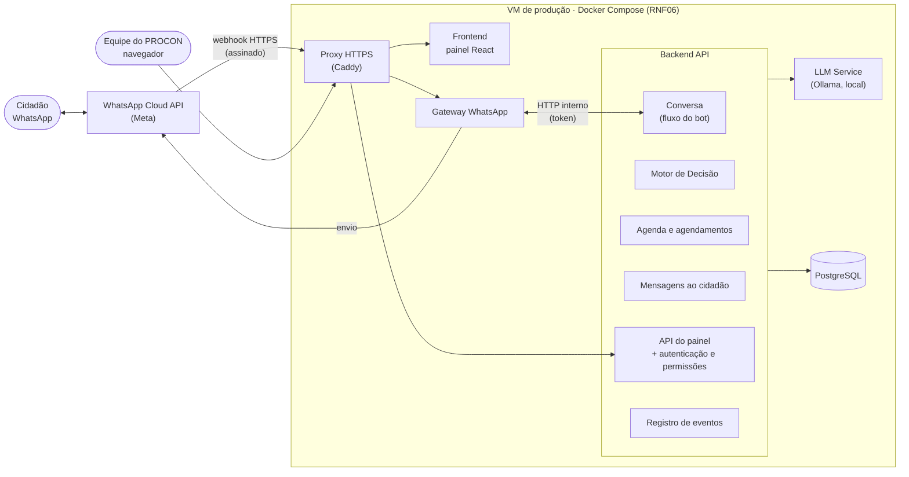
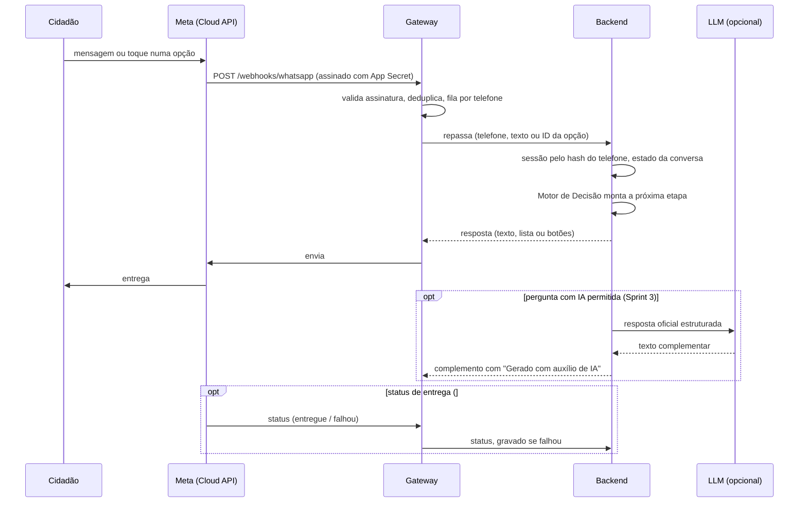

# Arquitetura — ProconChat Jacareí

> Atualizado em 19/10/2026, no fechamento da Sprint 2, com o estado de `develop` depois das issues #16, #51 a #58, #60, #61, #81 a #86 e do PR #115. A arquitetura alvo foi definida em 27/09/2026, na revisão do protótipo do painel. Este documento descreve a arquitetura **alvo da entrega (23/11/2026)** e marca o que já está implementado. As decisões que levaram a ela estão em [`../decisoes/`](../decisoes/); as regras de cada tela, em [`../regras/`](../regras/).

**Legenda de estado:** ✅ implementado em `develop` · 🟡 planejado para a Sprint 2 · 🟠 planejado para a Sprint 3.

## Visão geral

O LLM Service só recebe chamadas do Backend e não tem acesso ao banco nem à sessão: ele **não tem como** decidir o fluxo (RP05). O Gateway não tem acesso ao banco nem aos segredos de hash: o tratamento de dados pessoais fica concentrado no Backend (RNF03).

## Componentes

| Componente | Papel | Container | Estado |
|---|---|---|---|
| **Gateway WhatsApp** | Recebe o webhook da Meta, valida a assinatura, deduplica, processa em fila por telefone e repassa ao Backend; envia as respostas do Backend (texto, lista, botões); lê a configuração do WhatsApp no Backend; envio de modelos e repasse dos status de entrega | `gateway` | ✅ Cloud API, respostas e configuração (#53, #83) · ✅ envio de modelos pela rota interna `POST /internal/whatsapp/messages/template` (#67) · 🟠 status de entrega (#88): hoje os eventos de status são descartados |
| **Backend API** | Orquestrador: conversa, Motor de Decisão, agenda, mensagens ao cidadão, registro de eventos, API do painel, autenticação e permissões | `backend` | ✅ parcial (ver módulos) · 🟠 demais módulos |
| **Frontend (painel)** | Painel da equipe do PROCON (RF08), a partir do `template-react` | `frontend` (nginx) | ✅ estrutura, layout, login, "Minha conta", Agendamentos, Detalhe do agendamento e WhatsApp (#58, #81, #84, #85, #86, #54); `/` redireciona para Agendamentos enquanto não há Dashboard (PR #115) · 🟠 Dashboard, Relatórios, Conteúdo, Sessões, Horários, Documentos e Usuários (hoje "Em construção") |
| **LLM Service** | Ollama com `llama3.2:3b`; gera só o texto complementar (RF05) | `ollama` + `llm-pull` | ✅ serviço pronto · 🟠 ligado ao fluxo (S3-05) |
| **PostgreSQL** | Persistência única | `postgres` (+ `migrate`, `seed`) | ✅ schema da Sprint 2 (#52) e migrations até a `16` (permissões das contas, #62) |
| **Proxy HTTPS** | Certificado e roteamento para painel, API e webhook; responde 404 nas rotas internas `/api/v1/whatsapp/sessions` e `/api/v1/internal*` | `caddy` | ✅ (`compose.prod.yaml`, `deploy/Caddyfile`) |
| ~~Evolution API + Redis~~ | Integração não oficial usada na Sprint 1 | `evolution-api`, `redis` | Removidos na #82. Ver [decisão 003](../decisoes/003-migracao-whatsapp-cloud-api.md) |

### Módulos do Backend

Não são containers separados: são módulos de código, organizados no padrão Controller → Service → Repository. O RP03 pede modularidade **lógica**; só o LLM justifica um container próprio, porque carrega um modelo inteiro em memória.

| Módulo | Responsabilidade | Estado |
|---|---|---|
| **Conversa** | Máquina de estados do bot: saudação, listas, "resolveu?", agendamento, retorno, timeout de 30 minutos, pausa | ✅ saudação, listas, "resolveu?", agendamento, timeout com varredura periódica e pausa (#55, #56, #83) · 🟠 retorno de quem já tem agendamento (#59) |
| **Motor de Decisão** | Lê categorias e perguntas do banco e monta as opções e a resposta final. Não guarda estado | ✅ com paginação e categoria oculta |
| **Agenda** | Calcula horários livres a partir da configuração; cria, remarca e cancela agendamentos; controla vagas com concorrência | ✅ horários livres e reserva com trava por horário (#56) · 🟠 remarcar e cancelar (#59) |
| **Mensagens ao cidadão** | Monta os textos fixos (confirmação, pausa) e os modelos (cancelamento, lembrete); registra falhas de envio | ✅ textos fixos de confirmação e de pausa · ✅ modelo do aviso de cancelamento, com a falha síncrona de envio no histórico e o reenvio (#67) · 🟠 lembrete (#74) e falhas de entrega assíncronas (#88) |
| **Registro de eventos** | Grava cada passo da conversa e o desfecho da sessão | ✅ (#16) |
| **API do painel** | Agendamentos, conteúdo, configuração, usuários, relatórios, configuração do WhatsApp | ✅ agendamentos: lista, detalhe, assumir, atendido e não compareceu (#60), usados pelas telas de Agendamentos e Detalhe (#85, #86); atribuir, corrigir registro, observações internas, lista de funcionários e calendário semanal (#87, telas na #126); configuração do WhatsApp (#83); contas e permissões: listar, criar, salvar em lote, redefinir senha e agendamentos futuros de uma conta (#62, tela na #123) · 🟠 demais |
| **Autenticação e permissões** | Login, sessão, `requirePermission` com 8 permissões marcadas por conta; o Admin tem todas | ✅ login, sessão, troca de senha e `requirePermission` (#57, #84); permissões reais de cada conta, lidas a cada requisição, e regras contra escalada validadas na API (#62) |
| **LLM** | Cliente do Ollama com fallback; envio do complemento com rótulo | ✅ cliente · 🟠 ligado ao fluxo (S3-05, #66) |

## Fluxos principais

### Mensagem do cidadão

Hoje o Gateway recebe os eventos de status da Meta e os descarta (`status_update` no log). O registro das falhas de entrega é da #88.

### Mensagem iniciada pelo sistema

Aviso de cancelamento pela equipe (✅ #67) e lembrete (🟠 #74). O Backend decifra o telefone guardado no agendamento e pede ao Gateway o envio de um **modelo aprovado pela Meta**, porque fora da janela de 24h não se pode enviar texto livre. Ver [decisão 005](../decisoes/005-mensagens-ao-cidadao.md).

### Configuração do WhatsApp

As credenciais da Cloud API ficam no banco, **criptografadas com uma chave-mestra do `.env`**, e são editadas pela tela de WhatsApp (só Admin). O Gateway busca a configuração no Backend por um endpoint interno, guarda em cache e recarrega quando o Admin salva. Assim o PROCON troca o número sem mexer no servidor.

## Infraestrutura e entrega

| Ambiente | Onde | WhatsApp |
|---|---|---|
| **Desenvolvimento** | Máquina de cada pessoa (`docker compose up`) + túnel HTTPS | App de teste próprio na Meta, com o número de teste gratuito da Meta |
| **Produção / demonstração** | VM AWS EC2 `t4g.small` (arm64, 2 GB + 2 GB de swap) em `us-east-2`, com `compose.prod.yaml`: `caddy`, `postgres`, `migrate`, `seed`, `backend`, `gateway` e `frontend`. Sem Evolution e Redis. O Ollama (`ollama` e `llm-pull`, perfil `llm`) fica desligado até haver uma VM com mais memória (#66) | Número real da equipe; depois das sprints, o número do PROCON |

- **CI** (✅ #58, `.github/workflows/ci.yml`): GitHub Actions roda, em todo PR e push para `develop` e `main`, formatação, lint, build e testes do frontend; lint, build e testes do backend (com `typecheck:test`) e do gateway; e, com um Postgres, as migrations, os testes de integração e o `test:db` do backend. O CI verde é obrigatório para o merge.
- **CD** (✅ #51): push com CI verde na branch de `DEPLOY_BRANCH` (hoje `develop`; `main` no fim do semestre) gera as imagens no GitHub Container Registry e atualiza a VM por SSH com `deploy/deploy.sh <sha>`. As migrations rodam pelo serviço `migrate`. Operação, rollback e backup: [`infra/deploy.md`](../infra/deploy.md).
- **Segredos:** no GitHub, só os de acesso SSH (environment `production`); os da aplicação ficam no `.env` da VM. Continuam no `.env`: banco, `PHONE_HASH_SECRET`, `CPF_HASH_SECRET`, segredo dos cookies de sessão do painel (`AUTH_TOKEN_SECRET`), conta Admin inicial (`ROOT_EMAIL`, `ROOT_PASSWORD`), token interno Gateway ↔ Backend (`GATEWAY_INTERNAL_TOKEN`), chave-mestra de criptografia (`ENCRYPTION_KEY`) e URL pública (`PUBLIC_BASE_URL`, derivada de `SITE_ADDRESS` em produção).

## Segurança e dados pessoais

- **Telefone:** nas sessões, só o hash (`phone_hash`); nos agendamentos, criptografado e apagado quando o agendamento termina. Nunca aparece no painel.
- **CPF:** hash + versão mascarada. O CPF completo nunca é exibido.
- **Texto digitado pelo cidadão:** não é gravado.
- **Webhook:** só aceita eventos com assinatura válida da Meta.
- **Painel:** toda rota exige sessão e a permissão correspondente, validadas no servidor. As regras contra escalada de privilégio estão na [decisão 004](../decisoes/004-contas-e-permissoes-granulares.md).
- Detalhes: [decisão 002](../decisoes/002-lgpd-dados-pessoais.md).

## Stack

| Camada | Tecnologia |
|---|---|
| Backend e Gateway | Node.js + TypeScript, Express, Vitest |
| Frontend | React 19 + Vite + TypeScript, React Router, Vitest + Testing Library, oxlint + prettier (a partir do `template-react`) |
| Banco | PostgreSQL 15, migrations com `node-pg-migrate` |
| LLM | Ollama + `llama3.2:3b` (local; RP05) |
| WhatsApp | WhatsApp Cloud API (Meta) |
| Infra | Docker Compose, Caddy, GitHub Actions, GitHub Container Registry, VM na nuvem |

## Modelo de dados

Ver [`../database/database.md`](../database/database.md): o schema atual e o planejado para a Sprint 3.

## Como a arquitetura atende aos requisitos

| Requisito | Como |
|---|---|
| RF01, RP01 | Cloud API oficial pelo Gateway |
| RF02, RF03 | Motor de Decisão e Conversa, com listas e botões tocáveis (a escolha chega como ID, não como texto interpretado) |
| RF04, RNF04 | Resposta final montada no Backend com "O que fazer agora" e o aviso de texto único |
| RF05, RNF05, RP05 | LLM local, chamado só pelo Backend, sem acesso ao banco; complemento sempre rotulado |
| RF06 | Registro de eventos e desfechos; relatórios agregados |
| RF07 | Módulos Agenda e Mensagens ao cidadão |
| RF08 | Frontend + API do painel com permissões |
| RNF02 | Resposta oficial não espera o LLM; `restart` e healthchecks; Cloud API em vez de automação não oficial |
| RNF03 | Seção "Segurança e dados pessoais" |
| RNF06 | Tudo no Docker Compose |
| RNF08 | CI em todo PR e CD a cada push com CI verde na branch de `DEPLOY_BRANCH` (`develop` durante o semestre, `main` no fim) |
| RP03 | Gateway, Backend e LLM separados; módulos internos no Backend |
