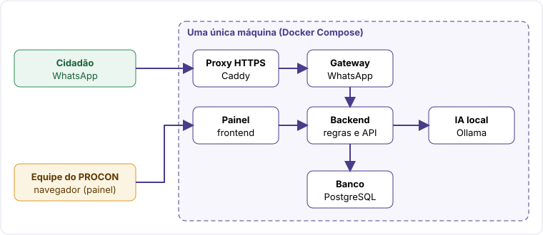

# O que é o ProconChat

O ProconChat Jacareí é um chatbot de orientação ao consumidor pelo WhatsApp, feito para o PROCON de Jacareí-SP. Ele foi desenvolvido no 6º semestre do curso de Desenvolvimento de Software Multiplataforma da Fatec Jacareí.

O cidadão conversa com o bot pelo WhatsApp. O bot conduz a conversa por perguntas e opções definidas pelo PROCON e entrega, ao final, uma orientação com a base legal, os documentos necessários e os próximos passos. Quando a orientação não resolve, o cidadão pode agendar um atendimento presencial. A equipe do PROCON acompanha os atendimentos e configura o bot por um painel web.

## O que o sistema faz

| Para quem | O que oferece |
| --- | --- |
| Cidadão | Orientação sobre direitos do consumidor pelo WhatsApp, por perguntas e opções. Agendamento, remarcação e cancelamento de atendimento presencial. Lembrete antes do atendimento |
| Equipe do PROCON | Painel web para acompanhar os agendamentos, configurar horários, documentos e conteúdo do bot e ver relatórios e sessões, conforme as permissões de cada conta |
| Administrador | Tudo que a equipe faz, mais a gestão de contas e a configuração do número do WhatsApp, que só o Administrador acessa |

> **Atenção:** a orientação do bot tem caráter informativo. Ela não é vinculante e não substitui o atendimento jurídico ou administrativo formal do PROCON.

## A quem este documento se destina

A uma pessoa técnica de fora do time de desenvolvimento que precise entender o sistema e colocá-lo no ar. Ele cobre a visão geral, as regras de proteção de dados e de uso de IA, os requisitos de hardware e software, a instalação, a atualização e o procedimento de redefinição da senha do Administrador.

O sistema descrito aqui é o sistema completo, com a IA local (Ollama), em uma única máquina. Este documento é um resumo da documentação do projeto (pasta `.docs/` do repositório): quando houver diferença sobre regras e procedimentos, vale a documentação do repositório. O modo de instalação descrito aqui não muda por causa disso.

# Como o sistema funciona

Todos os componentes rodam em containers Docker, em uma única máquina, orquestrados por Docker Compose. Isso inclui o modelo de IA.


*Figura 1 – Componentes do sistema, todos na mesma máquina*

## Componentes

| Componente | Para que serve |
| --- | --- |
| Proxy HTTPS (Caddy) | Único ponto exposto à internet (portas 80 e 443). Emite o certificado HTTPS sozinho e encaminha o tráfego para o painel, a API e o webhook do WhatsApp |
| Gateway WhatsApp | Recebe as mensagens enviadas pela Meta (WhatsApp Cloud API), confere a assinatura de cada uma, organiza a fila por telefone e envia as respostas |
| Backend | Cérebro do sistema: conduz a conversa, monta as respostas, calcula horários livres, cuida dos agendamentos, expõe a API do painel e controla login e permissões |
| Painel (frontend) | Site usado pela equipe do PROCON |
| Banco de dados (PostgreSQL) | Guarda conteúdo, agenda, contas, registros de atendimento e configurações |
| IA local (Ollama, modelo `llama3.2:3b`) | Reescreve a explicação da resposta oficial em linguagem natural. Roda na própria máquina |

Além desses, três serviços rodam uma vez e encerram: `migrate` (cria e atualiza as tabelas do banco), `seed` (carrega o conteúdo inicial, a conta Administrador e a configuração do WhatsApp) e `llm-pull` (baixa o modelo de IA na primeira subida).

## Caminho de uma mensagem

1. O cidadão envia uma mensagem ou toca numa opção no WhatsApp.
2. A Meta entrega a mensagem ao sistema por um webhook HTTPS assinado. O proxy encaminha ao gateway.
3. O gateway confere a assinatura, descarta repetições e repassa ao backend.
4. O backend identifica a conversa, decide o próximo passo pelas regras cadastradas e monta a resposta.
5. O gateway envia a resposta pelo WhatsApp.

Quando a pergunta permite o complemento por IA, o cidadão vê "digitando…" no WhatsApp enquanto a IA escreve a explicação. Em seguida, recebe uma única mensagem com a explicação, o bloco oficial, o aviso e os botões. Se a IA não puder ser usada, o cidadão recebe a resposta oficial completa, nas mensagens de sempre.

## Painel da equipe

O painel é um site protegido por login. Cada conta tem permissões próprias, conferidas no servidor a cada requisição. A conta Administrador tem todas as permissões. Não existe "esqueci minha senha" no painel: a redefinição da senha do Administrador é um procedimento técnico no servidor, descrito no capítulo de atualização e operação.

# Proteção de dados e uso de IA

Estas regras valem em todo o sistema e fazem parte do desafio proposto pelo PROCON e pela Fatec.

## Dados pessoais (LGPD)

| Regra | Como o sistema cumpre |
| --- | --- |
| O telefone nunca é guardado em texto puro | Nas conversas, só um código calculado a partir do telefone (hash), que não permite recuperar o número. No agendamento, o telefone é guardado criptografado, só para enviar avisos |
| O telefone do agendamento é apagado no horário do atendimento | Uma rotina do backend, a cada 60 segundos, apaga o telefone dos agendamentos cujo horário chegou |
| O texto digitado pelo cidadão nunca é guardado | O sistema registra só os passos percorridos na conversa, nunca o que a pessoa escreveu |
| CPF | Guardado como hash e em versão mascarada. O CPF completo nunca aparece no painel |
| Base legal | Execução do serviço que o próprio cidadão pediu. Não há consentimento separado |
| Conversas e agendamentos antigos | O Administrador pode ligar a anonimização automática por prazo na aba Privacidade do painel |
| Política de privacidade | Página pública `/privacidade` do painel |
| Credenciais do WhatsApp | Guardadas criptografadas no banco, com uma chave-mestra que fica só no arquivo `.env` do servidor |
| Cópias de segurança | Dumps diários do banco, guardados por 7 dias. Um telefone já apagado pode permanecer num dump por menos de 7 dias |

> **Atenção:** os segredos `PHONE_HASH_SECRET`, `CPF_HASH_SECRET`, `ENCRYPTION_KEY` e `POSTGRES_PASSWORD` não podem mudar depois do primeiro uso. Trocá-los quebra a ligação entre conversas antigas e novas, impede a busca por CPF e deixa ilegíveis as credenciais do WhatsApp salvas.

## Uso de inteligência artificial

| Regra | Significado |
| --- | --- |
| A IA nunca decide o fluxo | Quem escolhe o passo da conversa e os botões é o código, a partir das regras cadastradas, antes de a IA ser chamada. A IA só reescreve a explicação da resposta oficial já escolhida |
| Toda resposta com IA é identificada | A mensagem no WhatsApp leva "Gerado com auxílio de IA" no rodapé. No painel, a marca aparece na linha do tempo |
| Toda resposta final avisa que é informativa | Texto único: "Esta é uma orientação automatizada de caráter informativo. Ela não é vinculante e não substitui o atendimento jurídico ou administrativo formal do PROCON Jacareí." |
| Nenhuma API externa de LLM | O modelo roda na própria máquina do sistema (Ollama). Nenhum texto sai para serviços de IA de terceiros, nem gratuitos |
| Nenhum dado pessoal vai ao modelo | O pedido à IA leva só o texto oficial da resposta (categoria, pergunta do catálogo, base legal, resposta, documentos e próximos passos). Nunca o telefone nem o que o cidadão digitou |
| A resposta oficial é sempre a alternativa | Se a IA estiver fora do ar, demorar além do limite, errar números ou passar do tamanho permitido, o cidadão recebe o texto oficial. A reescrita só é usada se citar todos os números do texto oficial e nenhum número novo |
| A equipe controla onde a IA atua | Cada pergunta tem a opção "Permitir complemento por IA". Perguntas fora do escopo nunca usam IA |

# Requisitos de hardware e software

## Meta de desempenho da IA

A meta de hardware é que a IA (Ollama, modelo `llama3.2:3b`) entregue a resposta em até 10 segundos. A máquina precisa ser dimensionada para isso. O limite de espera do sistema pela IA é definido pela variável `LLM_TIMEOUT_MS` (padrão: 20 segundos). Passado esse limite, o cidadão recebe a resposta oficial.

## Resultado dos testes

Os requisitos abaixo vêm de testes reais, feitos em 20/11/2026, com o sistema completo no Docker Compose e o Ollama limitado por container.

| Item | Como foi o teste |
| --- | --- |
| Máquina | Intel Core i7-13650HX (x86-64, 13ª geração), 7 núcleos físicos (13 CPUs lógicas), 20,5 GB de RAM visíveis ao Docker, Windows com WSL2, Docker 29.10, sem placa de vídeo |
| Sistema | Banco, backend, gateway, painel e Ollama 0.40.2 com o modelo `llama3.2:3b` (2,0 GB). O proxy Caddy, que só existe na configuração de produção, não participou |
| Limite de CPU | O Ollama foi preso a 2, 3, 4, 6, 7 e 13 CPUs, cada uma num núcleo físico diferente (exceto na de 13), com o número de threads igual ao de CPUs |
| Limite de memória | Limite do container do Ollama, sem swap, de 6 GB até 2 GB |
| Geração | O mesmo código e o mesmo pedido que o backend usa (limite de 300 tokens), com 46 respostas oficiais reais do banco (de 79 a 556 caracteres), uma geração por vez |
| Amostra | 20 gerações com o modelo já carregado em cada configuração de 4, 6, 7 e 13 CPUs e 10 nas de 2 e 3 CPUs. A primeira geração, com o modelo ainda frio, é medida à parte |

### Tempo da resposta por número de CPUs

Tempos em segundos, com o modelo já carregado e 6 GB de memória.

| CPUs | Gerações | Média | Pior caso | Respostas acima de 10 s |
| --- | --- | --- | --- | --- |
| 13 (todas) | 20 | 6,75 | 11,48 | 1 |
| 7 | 20 | 6,65 | 12,14 | 3 |
| 6 | 20 | 6,46 | 11,58 | 2 |
| 4 | 20 | 7,29 | 17,91 | 1 |
| 4 (repetição com 4 GB) | 20 | 8,53 | 16,37 | 7 |
| 3 | 10 | 8,48 | 11,61 | 2 |
| 2 | 10 | 11,42 | 15,43 | 7 |

Acima de 6 CPUs não houve ganho: a geração passa a depender da velocidade da memória. Com 2 CPUs a média passa de 10 s. O tempo cresce com o tamanho da resposta: as mais longas (acima de uns 500 caracteres) levaram mais de 10 s em quase todas as configurações.

### Memória do Ollama (4 CPUs)

| Limite | Resultado |
| --- | --- |
| 6 GB e 4 GB | Todas as gerações concluídas |
| 3 GB | Uma falha em 21 gerações (erro do Ollama), com o uso chegando a 3 GB |
| 2,5 GB | Container encerrado por falta de memória; metade das gerações falhou |
| 2 GB | Todas as gerações falharam |

O Ollama chegou a cerca de 3 GB em uso. Os outros serviços, parados, usam juntos cerca de 0,1 GB (banco 40 MB, backend 33 a 41 MB, gateway 20 MB e painel 11 MB).

### Modelo frio

A primeira geração depois que o modelo sai da memória leva cerca de 13 a 22 s (12,9 a 21,8 s medidos), em qualquer número de CPUs testado (12,9 s com 7 CPUs, 15,8 s com 13). O Ollama descarrega o modelo depois de alguns minutos sem uso, e a conversa seguinte paga o tempo de carregá-lo. Essa primeira resposta passa da meta de 10 s e, nas medições mais lentas (até 21,8 s), pode passar também do limite de espera de 20 s. Nesse caso o cidadão recebe a resposta oficial.

### Disco

| Item | Tamanho medido |
| --- | --- |
| Imagem do Ollama | 9,4 GB |
| Imagens do backend, gateway, painel e banco | cerca de 1,1 GB |
| Modelo `llama3.2:3b` | 2,0 GB |
| Banco recém-criado | 50 MB |
| Total na instalação | cerca de 12,6 GB |
| Cache da compilação (só no caminho 2B) | espaço extra durante o build (na medição do projeto, cerca de 1 GB) |

## Requisitos mínimos e recomendados

| Recurso | Mínimo | Recomendado |
| --- | --- | --- |
| CPU | 6 núcleos | 6 núcleos: os testes não mostraram ganho acima disso |
| Memória (RAM) | 8 GB: cerca de 3 GB para o Ollama (4 GB de limite, como testado), 0,1 GB para os demais serviços e o restante para o sistema operacional, o Docker e a compilação das imagens (caminho 2B) | 8 GB, sem outra aplicação pesada na mesma máquina |
| Disco | 20 GB livres | 40 GB, para backups, registros e versões antigas das imagens |
| Placa de vídeo | Não necessária | Não necessária |

O mínimo é a configuração em que quase todas as respostas saíram em até 10 s: com 6 núcleos, a média foi de 6,5 s, 2 respostas em 20 passaram de 10 s e o pior caso foi de cerca de 12 s. Com 4 núcleos a média ficou entre 7 e 9 s, mas de 1 a 7 respostas em 20 passaram de 10 s, por isso 4 núcleos não atendem à meta. A memória de 8 GB deixa folga sobre o uso medido do Ollama (cerca de 3 GB). O trecho do sistema operacional e da compilação nessa folga é estimativa, não medida.

Não há medição que justifique um recomendado acima do mínimo para a CPU: com 7 e 13 CPUs os tempos foram iguais aos de 6. A folga recomendada é só de disco, calculada sobre os 12,6 GB medidos mais o cache de compilação, os backups e os registros.

> **Atenção:** os testes foram feitos numa máquina x86 de alto desempenho, em WSL2. A produção do projeto usa uma máquina ARM, com núcleos mais lentos, e não foi medida. Nela os tempos tendem a ser maiores. Refaça a medição na máquina de destino antes de fixar o dimensionamento.

### Se o hardware não atingir a meta de 10 s

- O sistema continua funcionando: o cidadão espera pela IA até o limite de `LLM_TIMEOUT_MS` (padrão de 20 s), com o indicador "digitando…", e recebe a resposta oficial se a IA passar do limite.
- Para ganhar tempo, aumente os núcleos (o ganho para em 6), use uma CPU e uma memória mais rápidas e dê ao Ollama pelo menos 4 GB de memória (abaixo de 3 GB as gerações falham).
- Confira que o sistema não está disputando CPU com outros programas na mesma máquina.
- Não altere o código nem as configurações do sistema para compensar um hardware lento: a meta de 10 s é de dimensionamento da máquina.

## Software

| Item | Requisito |
| --- | --- |
| Sistema operacional | Linux de 64 bits com suporte ao Docker. A produção do projeto usa Ubuntu 24.04 |
| Docker | Docker Engine com Docker Compose v2 (comando `docker compose`, sem hífen) |
| Rede | Portas 80 e 443 abertas à internet. A porta de acesso remoto (SSH, 22) fica aberta só para quem opera a máquina. Nenhuma outra porta deve ficar aberta |
| Endereço | Um nome de domínio que aponte para a máquina (ou um endereço `<ip>.sslip.io`), para o certificado HTTPS |
| WhatsApp | Conta da Meta com o WhatsApp Cloud API configurado e um número de telefone dedicado ao bot |
| Acesso à internet | Para baixar as imagens do sistema e o modelo de IA na instalação, e para falar com a Meta |

Não é preciso instalar Node.js, PostgreSQL nem o modelo de IA na máquina: tudo roda dentro dos containers.

# Instalação

Há três caminhos. O primeiro serve para conhecer e testar o sistema numa máquina, sem HTTPS. Os outros dois são de produção, com HTTPS e WhatsApp real: o 2A, com imagens prontas (máquina ARM64), e o 2B, compilando as imagens na própria máquina (x86/amd64).

## Caminho 1: testar a partir do código-fonte

Roda tudo na máquina, com as portas acessíveis só por ela mesma (`127.0.0.1`).

1. Instale o Docker e o Docker Compose v2.
2. Baixe o código do repositório e entre na pasta:

   ```bash
   git clone https://github.com/Steel-Hard/ProconChat_Jacarei.git
   cd ProconChat_Jacarei
   cp .env.example .env
   ```

3. Abra o `.env` e preencha duas chaves, cada uma com o resultado de `openssl rand -hex 32`:
   - `ENCRYPTION_KEY`: obrigatória, sem ela o Docker Compose recusa subir;
   - `AUTH_TOKEN_SECRET`: assina as sessões do painel.
4. Confira `ROOT_EMAIL` e `ROOT_PASSWORD` no `.env`. São o e-mail e a senha da conta Administrador criada na primeira subida. O `.env.example` traz valores de desenvolvimento (`admin@procon.local` e uma senha de exemplo); troque-os se a máquina for acessível por outras pessoas.
5. Suba tudo:

   ```bash
   docker compose up --build -d
   ```

6. Acompanhe até todos os serviços ficarem saudáveis (o `llm-pull` baixa o modelo de IA, cerca de 2 GB, e encerra):

   ```bash
   docker compose ps -a
   ```

7. Abra o painel em `http://localhost:8081` e entre com `ROOT_EMAIL` e `ROOT_PASSWORD`.

Nesse modo não há HTTPS, e o WhatsApp real não consegue entregar mensagens à máquina. Use um dos caminhos de produção para isso.

> **Dica:** o arquivo `.env.example` traz valores de desenvolvimento. Nunca os use em produção.

## O que é comum aos dois caminhos de produção

A produção usa o arquivo `compose.prod.yaml` e o proxy Caddy para o HTTPS. Antes de começar:

1. Prepare a máquina: instale o Docker Engine pelo repositório oficial, ative-o na inicialização (`sudo systemctl enable --now docker`) e crie um usuário sem privilégios de administrador, no grupo `docker`, para operar o sistema. Abra no firewall só as portas 80, 443 e a de acesso remoto (SSH, 22).
2. Garanta que o endereço público (`SITE_ADDRESS`) aponte para a máquina e que as portas 80 e 443 estejam alcançáveis. O `deploy.sh` confere o endereço público no final e falha se ele não responder.
3. Crie o arquivo `.env` na pasta da aplicação, a partir de `deploy/.env.prod.example`, com permissão `600`. Gere cada segredo com `openssl rand -hex 32`. Variáveis:

   | Variável | O que colocar |
   | --- | --- |
   | `SITE_ADDRESS` | Endereço público, sem `https://`. Precisa ser exatamente o endereço que o navegador usa, senão o login responde `403 INVALID_ORIGIN`. Para testar na própria máquina, use `localhost` |
   | `IMAGE_OWNER` | Dono das imagens, em minúsculas: `steel-hard` |
   | `COMPOSE_PROFILES` | `llm`, para subir a IA local (Ollama) na mesma máquina |
   | `POSTGRES_USER` | `proconchat` |
   | `POSTGRES_PASSWORD` | Segredo gerado |
   | `PHONE_HASH_SECRET` | Segredo gerado |
   | `CPF_HASH_SECRET` | Segredo gerado |
   | `GATEWAY_INTERNAL_TOKEN` | Segredo gerado |
   | `AUTH_TOKEN_SECRET` | Segredo com 32 ou mais caracteres |
   | `ENCRYPTION_KEY` | Exatamente 64 caracteres hexadecimais |
   | `ROOT_EMAIL` | E-mail da conta Administrador |
   | `ROOT_PASSWORD` | Senha inicial do Administrador, de 8 caracteres a 72 bytes |
   | `WHATSAPP_PHONE_NUMBER_ID` | ID do número do bot no app da Meta |
   | `WHATSAPP_BUSINESS_ACCOUNT_ID` | ID da conta do WhatsApp Business |
   | `WHATSAPP_ACCESS_TOKEN` | Token permanente de usuário do sistema (o temporário expira em 24 h) |
   | `WHATSAPP_APP_SECRET` | Chave secreta do app da Meta |
   | `WHATSAPP_VERIFY_TOKEN` | Token de verificação do webhook, escolhido por você |
   | `WHATSAPP_GRAPH_API_VERSION` | `v26.0` |
   | `OLLAMA_URL` | Deixe vazia: a IA é o container local |
   | `LLM_MODEL` | `llama3.2:3b` |
   | `LLM_TIMEOUT_MS` | `20000` (padrão) |
   | `BACKUP_RETENTION_DAYS` | `7` |

   As variáveis `WHATSAPP_*` servem só para a primeira subida; depois, o número e as credenciais são editados pela tela de WhatsApp do painel.

> **Atenção:** `ROOT_PASSWORD` não pode sair do `.env`. O `deploy.sh` confere essa senha em todo deploy e para sem fazer nada se ela estiver vazia ou fora da regra.

## Caminho 2A: produção com imagens prontas (ARM64)

As imagens publicadas pelo projeto no registro de containers do GitHub (GHCR) são para a arquitetura ARM64, a da produção atual.

1. Crie a pasta da aplicação, por exemplo `/opt/proconchat`, e copie para ela o `compose.prod.yaml` e a pasta `deploy/` do repositório. Crie o `.env` nela, como descrito acima.
2. Escolha a tag das imagens. A tag é o código completo (40 caracteres) do commit de onde as imagens foram geradas. Cada deploy bem-sucedido do projeto publica as três imagens (`proconchat-backend`, `proconchat-gateway` e `proconchat-frontend`) com essa tag em `ghcr.io/steel-hard`. Para achar uma que exista, abra `https://github.com/orgs/Steel-Hard/packages`, entre em `proconchat-backend` e copie uma tag da lista, conferindo que as outras duas imagens têm a mesma tag. A tag em uso numa máquina já instalada é a última linha do arquivo `releases.log`.
3. Rode o deploy:

   ```bash
   cd /opt/proconchat
   ./deploy/deploy.sh <tag>
   ```

   O script confere as variáveis do `.env` (e para sem mexer em nada se alguma for inválida), baixa as imagens, sobe os serviços, espera ficarem saudáveis, confere o endereço público e registra a tag em `releases.log`. Na primeira subida, o `llm-pull` baixa o modelo de IA.

4. Confira o resultado:

   ```bash
   export IMAGE_TAG="$(tail -n 1 releases.log | cut -d' ' -f2)"
   docker compose -f compose.prod.yaml ps -a
   ```

   Os serviços de longa duração devem estar em execução, e `backend` e `gateway` saudáveis. Abra `https://<SITE_ADDRESS>` e entre com a conta Administrador.

## Caminho 2B: produção em máquina x86/amd64 (imagens compiladas na máquina)

Como as imagens publicadas são ARM64, numa máquina x86 você compila as três imagens a partir do código e o `deploy.sh` usa as imagens locais.

1. Instale Docker e Git e prepare a máquina como descrito acima. Use uma máquina que atenda ao mínimo de 8 GB de RAM.
2. Baixe o código na pasta da aplicação (ela vira a raiz do sistema) e escolha o commit a instalar:

   ```bash
   sudo install -d -o "$USER" /opt/proconchat
   git clone https://github.com/Steel-Hard/ProconChat_Jacarei.git /opt/proconchat
   cd /opt/proconchat
   git checkout <commit-ou-branch>
   TAG="$(git rev-parse HEAD)"
   ```

3. Crie o `.env` na pasta `/opt/proconchat`, como descrito acima.
4. Compile as três imagens, uma de cada vez, com o nome e a tag que o `compose.prod.yaml` espera (troque `steel-hard` se mudou `IMAGE_OWNER`):

   ```bash
   docker build --target runtime \
     -t "ghcr.io/steel-hard/proconchat-backend:$TAG" \
     src/backend
   docker build --target runtime \
     -t "ghcr.io/steel-hard/proconchat-gateway:$TAG" \
     src/gateway
   docker build --target runtime \
     --build-arg VITE_API_URL= \
     -t "ghcr.io/steel-hard/proconchat-frontend:$TAG" \
     src/frontend
   ```

   O `--build-arg VITE_API_URL=` (vazio) faz o painel chamar a API no mesmo endereço em que é aberto. A compilação usa espaço extra de cache em disco; depois do build, libere-o com `docker builder prune -f`.
5. Rode o deploy com a mesma tag. Como as três imagens já existem na máquina, o script só baixa o `postgres`, o `caddy` e o Ollama:

   ```bash
   ./deploy/deploy.sh "$TAG"
   ```

6. Confira o resultado como no caminho 2A.

Para atualizar uma máquina x86, rode `git fetch`, `git checkout <commit-novo>`, defina `TAG` de novo e repita os passos 4 e 5. O `deploy.sh` apaga, uma vez por deploy, as imagens sem uso com mais de uma semana, e um rollback para uma tag antiga exige compilar de novo.

## Configurar o WhatsApp na Meta

Depois de o sistema estar no ar, no app da Meta, em WhatsApp, Configuração, Webhook, informe a URL de callback `https://<SITE_ADDRESS>/webhooks/whatsapp` e o token de verificação mostrado na tela de WhatsApp do painel (o mesmo `WHATSAPP_VERIFY_TOKEN` da primeira subida). Assine o campo `messages`. Mande uma mensagem ao número do bot e confira a resposta.

# Atualização e operação

## Atualizar para uma versão nova

No projeto, cada alteração aprovada na branch de entrega gera imagens novas e atualiza o servidor sozinha, pelo GitHub Actions (CI e CD). Para atualizar manualmente, na pasta da aplicação:

```bash
./deploy/deploy.sh <tag-nova>
```

O `deploy.sh` aplica as migrações do banco antes de subir o backend novo. Se a migração falhar, o backend novo não sobe, mas os serviços já foram recriados e o sistema pode ficar fora do ar até a correção. Faça um backup antes de atualizar.

Para pegar correções das imagens de terceiros (`postgres` e `caddy`), baixe-as antes do deploy:

```bash
export IMAGE_TAG="$(tail -n 1 releases.log | cut -d' ' -f2)"
docker compose -f compose.prod.yaml pull postgres caddy
./deploy/deploy.sh "$IMAGE_TAG"
```

## Voltar para a versão anterior

```bash
tail -n 5 releases.log
./deploy/deploy.sh <tag-anterior>
```

> **Atenção:** as migrações do banco não voltam no rollback. O código só deve voltar se a migração nova for compatível com ele.

Para desfazer a última migração (manual, com backup antes), rode com a tag nova, a que ainda está no ar, e só depois volte o código:

```bash
export IMAGE_TAG="$(tail -n 1 releases.log | cut -d' ' -f2)"
./deploy/backup.sh
docker compose -f compose.prod.yaml run --rm migrate npm run db:rollback
./deploy/deploy.sh <tag-anterior>
```

## Backup

O script `deploy/backup.sh` grava um dump do banco em `backups/proconchat-AAAA-MM-DD.dump` e apaga os mais antigos que a retenção (`BACKUP_RETENTION_DAYS`, padrão 7). Agende-o uma vez por dia no `cron` do usuário de operação:

```text
30 3 * * * /opt/proconchat/deploy/backup.sh >> /opt/proconchat/backups/backup.log 2>&1
```

Os dumps ficam só no disco da máquina e contêm dados pessoais protegidos. Copie-os para fora da máquina se quiser proteção contra a perda dela, e apague essas cópias quando não forem mais necessárias.

## Redefinir a senha do Administrador

Não existe "esqueci minha senha" no painel, e ninguém pode redefinir a senha do Administrador por ele. Quem faz isso é a equipe técnica, diretamente no servidor, em um terminal interativo, com o usuário de operação:

1. Entre no servidor e vá para a pasta da aplicação (por exemplo `/opt/proconchat`).
2. Rode o script:

   ```bash
   ./deploy/reset-admin-password.sh
   ```

3. Digite a senha nova e repita. Ela não aparece na tela e precisa ter de 8 caracteres a 72 bytes. Se as duas não forem iguais ou a regra não for cumprida, nada é alterado.
4. Confirme a mensagem final "Senha do Admin redefinida". É o único sinal de que a senha mudou.
5. Entre no painel com o e-mail do Administrador e a senha nova.

O script descobre sozinho a tag em uso pelo `releases.log` e passa a senha ao container por variável de ambiente, sem deixá-la na linha de comando, no histórico do shell nem no `.env`. Todas as sessões abertas do Administrador são encerradas. O e-mail do Administrador não muda: `ROOT_EMAIL` só vale na criação da conta. Se a conta Administrador não existir, o script sai com erro e pede para rodar o `seed`.

## Diagnóstico rápido

```bash
cd /opt/proconchat
export IMAGE_TAG="$(tail -n 1 releases.log | cut -d' ' -f2)"
docker compose -f compose.prod.yaml ps -a
docker compose -f compose.prod.yaml logs --tail 100 backend
docker compose -f compose.prod.yaml logs --tail 100 gateway
docker compose -f compose.prod.yaml logs --tail 100 caddy
```

| Sintoma | Causa provável |
| --- | --- |
| `backend` ou `gateway` não ficam saudáveis | Variável obrigatória faltando ou inválida no `.env`, ou a migração do banco falhou. Veja os logs |
| O endereço público não responde e o resto está saudável | Certificado ainda não emitido, portas 80 e 443 fechadas no firewall, ou o endereço não aponta para a máquina |
| Login no painel responde `403 INVALID_ORIGIN` | `SITE_ADDRESS` diferente do endereço que o navegador usa |
| Cidadão recebe a resposta oficial, sem a explicação da IA | IA fora do ar, modelo ainda não baixado, resposta além do limite de espera, ou IA ocupada: o sistema faz uma geração por vez, e quem chega com a IA ocupada recebe a resposta oficial na hora. Veja `docker compose ps -a` e os registros do `ollama`. Se acontecer com frequência, o hardware está abaixo do dimensionamento do capítulo de requisitos |

Confira o espaço em disco de tempos em tempos, porque não há alerta automático:

```bash
df -h /
docker system df
```

## Onde está a documentação completa

Tudo o que este documento resume está detalhado na pasta `.docs/` do repositório: `infra/deploy.md` (produção, deploy, rollback, backup e diagnóstico), `architecture/architecture.md` (arquitetura), `decisoes/` (decisões de produto e arquitetura), `regras/` (regras de cada tela do painel) e `lgpd/` (pedidos do titular).
