# Antes de começar

## Para quem é este guia

Este guia é para a pessoa do PROCON que vai conectar o número de WhatsApp da instituição ao chatbot. Você não precisa saber programar. Precisa apenas de:

- o sistema já instalado e funcionando, com o endereço do painel em mãos;
- o acesso da conta **Admin** (e-mail e senha);
- um número de telefone que será o número oficial do atendimento;
- uma conta no Facebook de uma pessoa responsável, para criar a conta da Meta (a empresa dona do WhatsApp);
- uma forma de pagamento (cartão), necessária apenas para as mensagens de modelo (o lembrete e o aviso de cancelamento). O chatbot responde ao cidadão sem ela.

Só a conta Admin vê a tela de WhatsApp. Se o seu menu não mostra o item **WhatsApp**, você não está usando a conta Admin.

## O que você vai fazer

| Capítulo | O que acontece | Onde |
| --- | --- | --- |
| 1 | Entrar no sistema e trocar a senha do Admin | Painel do PROCON |
| 2 | Criar a conta na Meta, registrar o número e guardar o ID do número, o ID da conta e o App Secret | Site da Meta |
| 3 | Gerar o token permanente | Site da Meta |
| 4 | Cadastrar os dois modelos de mensagem | Site da Meta |
| 5 | Preencher a tela de WhatsApp, testar a conexão e salvar. Depois, configurar o webhook (o "recado" que a Meta envia ao sistema), conferir o estado do número e dos modelos, preencher a aba Privacidade e ligar os avisos | Painel do PROCON e site da Meta |
| 6 | Pausar e retomar o atendimento | Painel do PROCON |
| 7 | Resolver problemas comuns | Painel do PROCON |

> **Atenção:** a aprovação dos modelos de mensagem pela Meta leva de algumas horas a alguns dias. Por isso, faça os capítulos 2, 3 e 4 primeiro e deixe o restante para depois.

> **Atenção:** o número que for registrado na Meta para o chatbot deixa de funcionar no aplicativo WhatsApp comum do celular. Use um número dedicado ao atendimento.

> **Dica:** a Meta muda os nomes e a posição dos botões do site de tempos em tempos. Este guia cita os nomes das seções, que mudam pouco. Se algum botão estiver em outro lugar, procure pelo nome citado.

## Palavras que aparecem neste guia

| Palavra | O que significa |
| --- | --- |
| Meta | A empresa dona do WhatsApp, do Facebook e do Instagram |
| Painel de desenvolvedores da Meta | Um site da Meta (developers.facebook.com) onde fica o aplicativo e os códigos dele |
| Gerenciador de Negócios | Outro site da Meta (business.facebook.com), onde ficam a conta da empresa, os usuários e a forma de pagamento |
| Gerenciador do WhatsApp | Uma área do Gerenciador de Negócios (business.facebook.com/wa/manage), onde ficam os números e os modelos de mensagem |
| WhatsApp Business | O tipo de conta de WhatsApp para empresas, usado pelo chatbot |
| ID do número | Um código só de números que identifica o seu número na Meta |
| ID da conta | Um código só de números que identifica a sua conta do WhatsApp Business |
| Token | Uma "senha longa" que dá ao sistema permissão para usar o WhatsApp |
| App Secret | Uma chave secreta do aplicativo criado na Meta |
| Webhook | O canal pelo qual a Meta avisa o sistema que chegou uma mensagem |
| Modelo de mensagem | Um texto pronto, aprovado pela Meta, necessário para o sistema escrever primeiro ao cidadão |

# 1. Entrar no sistema e trocar a senha

## Entrar

1. Abra o endereço do painel no navegador.
2. Digite o e-mail e a senha da conta Admin. O seu login é o e-mail do Admin.
3. Clique em **Entrar**.

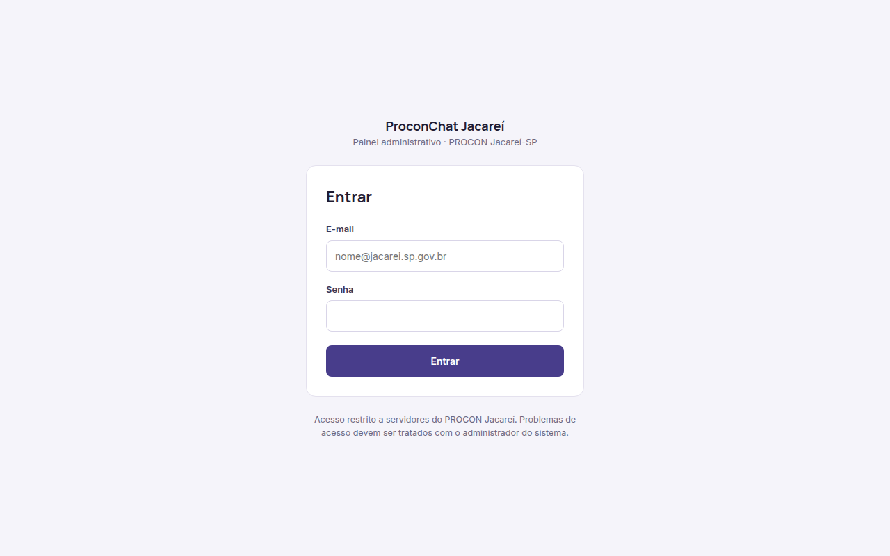
*Figura 1 – Tela de entrada do painel*

Depois de várias tentativas erradas, o acesso fica bloqueado por alguns minutos. Se isso acontecer, aguarde e tente de novo.

## Trocar a senha do Admin

A senha que veio com a instalação é conhecida pela equipe técnica. Troque-a no primeiro acesso.

1. No canto superior direito, clique em **Minha conta**.
2. Clique em **Alterar minha senha**.

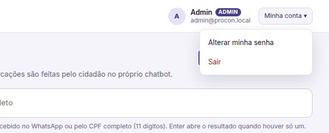
*Figura 2 – Menu Minha conta, com as opções Alterar minha senha e Sair*

3. Digite a **senha atual**, a **nova senha** e repita a nova senha em **Confirmar senha**.
4. Clique em **Salvar senha**.

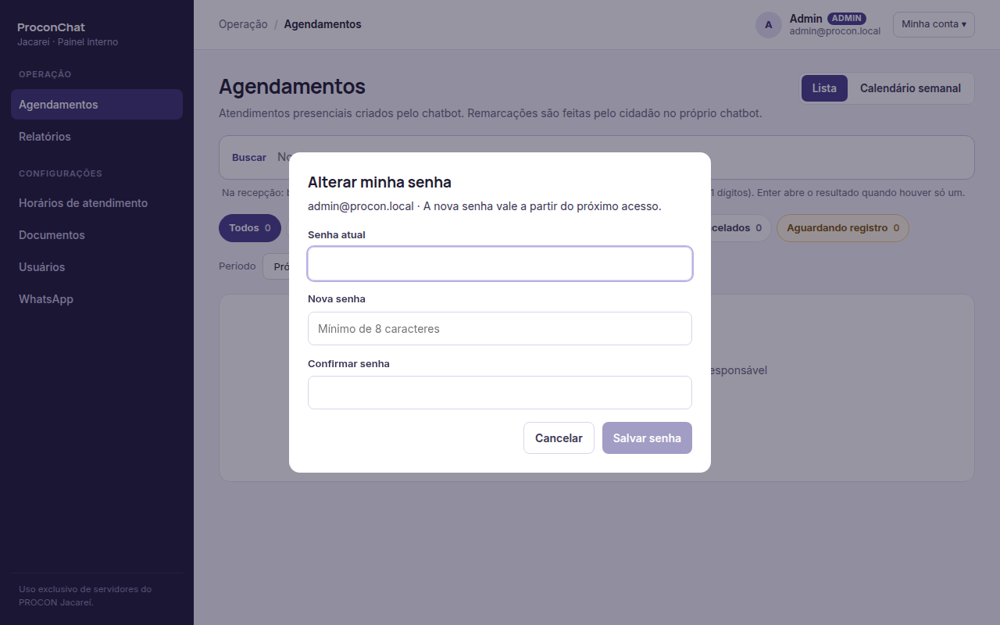
*Figura 3 – Janela de troca de senha*

A nova senha deve ter de 8 a 72 caracteres e vale a partir do próximo acesso.

> **Atenção:** anote a senha em lugar seguro. Não existe "Esqueci minha senha": se esquecer a senha do Admin, procure a equipe técnica, que a redefine diretamente no servidor.

# 2. Criar a conta na Meta e registrar o número

Esta parte é feita no site da Meta, fora do nosso painel. Os nomes abaixo podem mudar um pouco. Se ficar travado em algum passo na Meta, procure a equipe técnica.

> **Dica:** a Meta usa três lugares diferentes neste guia, e cada um é um site ou uma área à parte: o **Painel de desenvolvedores** (onde fica o aplicativo), o **Gerenciador de Negócios** (conta da empresa, usuários e pagamento) e o **Gerenciador do WhatsApp** (números e modelos de mensagem). Quando o guia citar um deles, entre nele pelo nome.

## Criar a conta

1. Entre com a conta do Facebook da pessoa responsável em **developers.facebook.com** e crie um aplicativo novo do tipo **Empresa** (em inglês, *Business*).
2. No painel do aplicativo, adicione o produto **WhatsApp**. A Meta cria uma conta do WhatsApp Business ligada ao aplicativo.
3. Em **Configurações do negócio** (no Gerenciador de Negócios, em **business.facebook.com**), confira se o negócio e a conta do WhatsApp Business aparecem. Eles ficam em **Contas** e **Contas do WhatsApp**.

> **Atenção:** tenha à mão uma forma de pagamento (cartão). Ela só é necessária para as mensagens de modelo (lembrete e aviso de cancelamento); o chatbot responde ao cidadão sem ela. Veja mais na seção Custo, no capítulo 4.

> **Dica:** use, de preferência, uma conta do Facebook que seja da instituição e que mais de uma pessoa de confiança consiga acessar. Assim, o acesso não se perde se alguém sair.

## Registrar o número

1. No Gerenciador do WhatsApp (**business.facebook.com/wa/manage**), abra a conta do WhatsApp Business.
2. Procure a seção de **Números de telefone** e clique para adicionar um número.
3. Informe o nome que as pessoas verão como remetente (por exemplo, "PROCON Jacareí") e o número.
4. A Meta envia um código por SMS ou ligação para o número. Digite o código para confirmar.

> **Atenção:** o nome exibido também passa por aprovação da Meta. Use o nome oficial da instituição.

> **Atenção:** o número de teste que a Meta oferece junto com o aplicativo serve só para experimentar. Ele aceita no máximo 5 destinatários cadastrados e pode não entregar mensagens para números do Brasil. Para o atendimento de verdade, use o número registrado da instituição.

## Guardar o ID do número e o ID da conta

Você vai precisar de dois códigos no capítulo 5. Anote-os agora.

1. No Painel de desenvolvedores da Meta, abra o aplicativo e vá em **WhatsApp**, **Configuração da API**.
2. Copie o **ID do número de telefone**.
3. Copie o **ID da conta do WhatsApp Business**, que aparece na mesma tela.

## Guardar o App Secret

1. No Painel de desenvolvedores da Meta, abra o aplicativo e vá em **Configurações do app**, **Básico**.
2. Ao lado de **Chave secreta do app** (App Secret), clique em mostrar. A Meta pode pedir a senha do Facebook.
3. Copie a chave e guarde-a com segurança.

> **Atenção:** o App Secret, o token e a senha do Admin nunca devem ser enviados por e-mail, mensagem ou colocados em documentos compartilhados.

# 3. Gerar o token permanente

> **Atenção:** a Meta mostra, na tela de **Configuração da API**, um token temporário. Ele expira em 24 horas e, depois disso, o chatbot para de responder. Não use esse token no atendimento real. Gere o token permanente, como descrito abaixo.

## Criar o usuário do sistema

1. Entre no Gerenciador de Negócios e abra **Configurações do negócio**.
2. Vá em **Usuários**, depois **Usuários do sistema**, e clique em **Adicionar**.
3. Dê um nome (por exemplo, `proconchat`) e escolha a função **Administrador**.

## Dar acesso ao aplicativo e à conta

1. Com o usuário do sistema selecionado, clique em **Atribuir ativos**.
2. Em **Apps**, escolha o aplicativo criado e dê **controle total**.
3. Em **Contas do WhatsApp**, escolha a conta do WhatsApp Business do PROCON e dê **controle total**.
4. Salve.

## Gerar o token

1. Com o usuário selecionado, clique em **Gerar novo token**.
2. Escolha o aplicativo.
3. Em validade, escolha **Nunca**.
4. Marque as duas permissões: `whatsapp_business_messaging` e `whatsapp_business_management`.
5. Clique em gerar e **copie o token na hora**: ele aparece uma única vez. Se perder, gere outro.

# 4. Cadastrar os modelos de mensagem

O WhatsApp só deixa a instituição escrever primeiro para o cidadão com **modelos de mensagem aprovados pela Meta**. O chatbot usa dois:

| Modelo | Para que serve | Nome que você deve usar |
| --- | --- | --- |
| Lembrete do atendimento | Avisa o cidadão, antes da data, do atendimento marcado | `lembrete_atendimento` |
| Aviso de cancelamento | Avisa o cidadão quando a equipe cancela um agendamento | `aviso_cancelamento` |

> **Atenção:** o nome, o idioma e o texto precisam ser **exatamente** os deste guia, letra por letra. Se algo for diferente, o sistema não consegue enviar a mensagem.

## Cadastrar cada modelo

1. Entre no Gerenciador do WhatsApp (**business.facebook.com/wa/manage**) com a conta que administra o WhatsApp Business do PROCON.
2. Abra **Ferramentas da conta** e depois **Modelos de mensagem**. Clique em **Criar modelo**.
3. Em categoria, escolha **Utilidade**. Não escolha Marketing.
4. Digite o **nome** da tabela acima, sem espaços e em letras minúsculas.
5. Em idioma, escolha **Português (BR)**.
6. No campo **Corpo**, cole o texto do modelo (veja abaixo).
7. Preencha os **exemplos** de cada variável com os valores sugeridos nas tabelas abaixo. A Meta usa os exemplos para analisar o modelo. Use sempre dados inventados, nunca dados de cidadãos reais.
8. Não adicione cabeçalho, rodapé nem botões.
9. Envie para análise.

## Modelo 1: lembrete do atendimento

Nome: `lembrete_atendimento`. Idioma: Português (BR). Categoria: Utilidade.

Texto do corpo:

```text
Olá, {{1}}. Lembrete do seu atendimento no PROCON Jacareí: {{2}}, {{3}}, às {{4}} (protocolo {{5}}). Endereço: {{6}}. Traga: {{7}}. Se não puder comparecer, remarque ou cancele respondendo a esta mensagem.
```

> **Atenção:** ao colar o texto na Meta, confira que ele ficou em um parágrafo só, sem quebras de linha, e que ficou idêntico ao acima, letra por letra. No PDF, o texto pode aparecer em várias linhas só por causa do tamanho da página.

| Variável | O que entra | Exemplo para a Meta |
| --- | --- | --- |
| `{{1}}` | Primeiro nome do cidadão | Maria |
| `{{2}}` | Dia da semana | quinta-feira |
| `{{3}}` | Data do atendimento | 05/11 |
| `{{4}}` | Hora do atendimento | 14:00 |
| `{{5}}` | Protocolo do agendamento | 1A2B3C4D |
| `{{6}}` | Endereço da unidade | Rua do Procon, 100 (Sala 1) |
| `{{7}}` | Documentos a levar | RG ou CNH; comprovante de residência |

## Modelo 2: aviso de cancelamento

Nome: `aviso_cancelamento`. Idioma: Português (BR). Categoria: Utilidade.

Texto do corpo:

```text
Olá, {{1}}. Seu agendamento {{2}} no PROCON Jacareí, marcado para {{3}} às {{4}}, foi cancelado. Motivo: {{5}}. Para agendar novamente, envie uma mensagem para este número.
```

> **Atenção:** ao colar o texto na Meta, confira que ele ficou em um parágrafo só, sem quebras de linha, e que ficou idêntico ao acima, letra por letra. No PDF, o texto pode aparecer em várias linhas só por causa do tamanho da página.

| Variável | O que entra | Exemplo para a Meta |
| --- | --- | --- |
| `{{1}}` | Primeiro nome do cidadão | Maria |
| `{{2}}` | Protocolo do agendamento | 1A2B3C4D |
| `{{3}}` | Data do atendimento | 05/11 |
| `{{4}}` | Hora do atendimento | 14:00 |
| `{{5}}` | Motivo do cancelamento | a unidade estará fechada nesta data |

> **Dica:** o aviso de cancelamento é opcional e vem desligado. Cadastre este modelo mesmo assim, para poder ligar o aviso depois sem esperar a aprovação.

## Custo

Cadastrar e aprovar um modelo não custa nada. A Meta pode cobrar pelo envio das mensagens de modelo, e os valores e as regras de cobrança mudam com o tempo. Consulte a tabela de preços atual da Meta antes de ligar os envios.

> **Atenção:** para enviar mensagens de modelo, a conta da Meta precisa ter uma **forma de pagamento** cadastrada. No Gerenciador de Negócios, abra o **Hub de faturamento (Billing Hub)** e depois **Formas de pagamento**, e cadastre um cartão. Sem isso, os avisos falham com o erro 131042. O chatbot continua respondendo normalmente ao cidadão.

## Os quatro status dos modelos

Depois de enviar, a Meta analisa o modelo. O painel do PROCON mostra o resultado em **Modelos de mensagem** (veja o capítulo 5). Enquanto um modelo não estiver **Aprovado**, o sistema não envia a mensagem dele.

| Status | O que significa | O que fazer |
| --- | --- | --- |
| Aprovado | A Meta aceitou o modelo. O sistema já pode usá-lo | Nada |
| Em análise | A Meta ainda está analisando | Aguardar, de algumas horas a alguns dias |
| Rejeitado | A Meta recusou o modelo | Abrir o modelo no Gerenciador do WhatsApp, ler o motivo, corrigir o texto e enviar de novo |
| Não encontrado | O modelo com esse nome e idioma não existe na conta | Conferir o nome e o idioma, ou cadastrar o modelo |

# 5. Preencher a tela de WhatsApp

Agora volte ao painel do PROCON. No menu lateral, em **Configurações**, clique em **WhatsApp**.

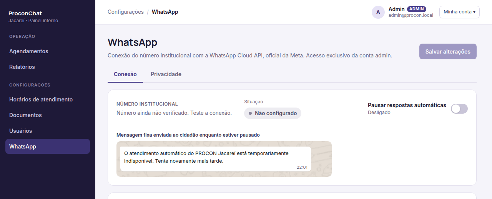
*Figura 4 – Tela de WhatsApp ainda não configurada: a situação aparece como "Não configurado"*

Na parte de cima, você vê o número institucional, a **situação** do atendimento e o interruptor de pausa. A situação pode ser:

| Situação | O que significa |
| --- | --- |
| Operando | Tudo certo, o chatbot está respondendo |
| Respostas pausadas | Alguém pausou o chatbot |
| Credenciais inválidas | A Meta recusou os dados salvos (por exemplo, token vencido) |
| Não verificado | Há um ID do número, mas os dados ainda não foram conferidos com a Meta |
| Não configurado | Ainda não há um ID do número |

## Preencher as credenciais

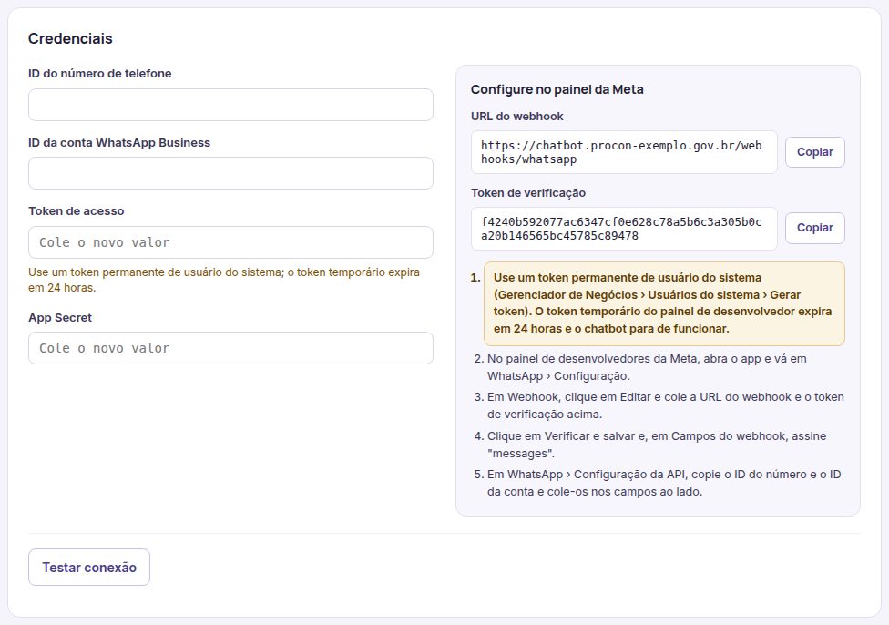
*Figura 5 – Seção Credenciais, ainda vazia*

1. Em **ID do número de telefone**, digite o ID guardado no capítulo 2. Só números.
2. Em **ID da conta WhatsApp Business**, digite o ID da conta. Só números.
3. Em **Token de acesso**, cole o token permanente do capítulo 3. Sem espaços.
4. Em **App Secret**, cole a chave secreta do capítulo 2. Sem espaços.

Todos os quatro campos são obrigatórios.

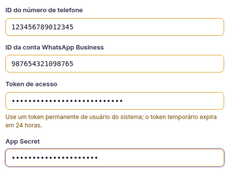
*Figura 6 – Credenciais preenchidas com dados de exemplo*

> **Atenção:** depois de salvos, o token e o App Secret nunca mais aparecem inteiros. A tela mostra só os quatro últimos caracteres, com o botão **Substituir**. Isso é de propósito, por segurança. Para trocar, clique em **Substituir** e cole o valor novo.

O campo do token também avisa sobre a validade. Se você vir "Este token expira em..." ou "Use um token permanente de usuário do sistema; o token temporário expira em 24 horas", gere o token permanente do capítulo 3.

## Testar a conexão

1. Com os quatro campos preenchidos, clique em **Testar conexão**.
2. Aguarde o resultado.

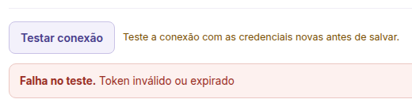
*Figura 7 – Resultado de um teste de conexão com falha (os dados usados na captura são inventados)*

- **Sucesso:** o painel mostra o número e o nome verificados pela Meta. Siga para o passo de salvar.
- **Erro:** o painel explica o motivo. Veja a tabela abaixo.

| Mensagem | O que fazer |
| --- | --- |
| Token inválido ou expirado | Gere um novo token permanente e cole de novo |
| App Secret inválido | Copie a chave de novo em Configurações do app, Básico |
| ID do número não encontrado ou sem acesso por este token | Confira o ID do número e se o usuário do sistema tem acesso à conta |
| ID da conta WhatsApp Business não encontrado ou sem acesso por este token | Confira o ID da conta e o acesso do usuário do sistema |
| O número não pertence a esta conta WhatsApp Business | O ID do número e o ID da conta são de contas diferentes. Confira os dois |
| O token não tem permissão para gerenciar este número | Gere o token de novo, marcando as duas permissões do capítulo 3 |
| Não foi possível falar com a Meta. Tente de novo em instantes | Aguarde alguns minutos e tente de novo |
| A Meta recusou as credenciais | Confira todos os campos, um por um |

## Salvar

1. Quando o teste der sucesso, clique em **Salvar alterações**, no canto superior direito.
2. O sistema testa de novo com a Meta. Se estiver tudo certo, salva. Se a Meta recusar, **nada é salvo** e a tela mostra o motivo.

> **Atenção:** dados novos só podem ser salvos depois de um teste com sucesso. Isso evita salvar dados errados e deixar o chatbot parado.

A seção **Histórico de alterações**, no fim da tela, registra quem mudou o quê e quando. Os valores do token e do App Secret nunca são registrados.

O próximo passo é configurar o webhook na Meta, logo abaixo.

## Configurar o webhook na Meta

Faça este passo **depois de salvar** as credenciais. O quadro do painel lista os passos da Meta em outra ordem; para não se perder, siga a ordem deste guia.

Ao lado das credenciais, o quadro **Configure no painel da Meta** mostra dois valores que o sistema gera para você: a **URL do webhook** e o **token de verificação**. Cada um tem o botão **Copiar**.

1. Clique em **Copiar** ao lado da **URL do webhook**.
2. No Painel de desenvolvedores da Meta, abra o aplicativo e vá em **WhatsApp**, **Configuração**.
3. Na parte **Webhook**, clique em **Editar** e cole a URL no campo de URL de retorno (callback).
4. Volte ao painel do PROCON, copie o **token de verificação** e cole no campo **Verificar token** da Meta.
5. Clique em **Verificar e salvar**.
6. Ainda na Meta, em **Campos do webhook**, assine o campo **messages**.

> **Atenção:** se no lugar da URL aparecer o aviso "A URL pública do sistema não está configurada no servidor", peça à equipe técnica para definir o endereço público do sistema. Sem ele, a Meta não consegue chamar o sistema.

> **Dica:** se a Meta recusar a verificação, confira se o token de verificação foi colado inteiro, sem espaço no começo ou no fim, e se é o mesmo que o painel mostra.

## Conferir o estado do número

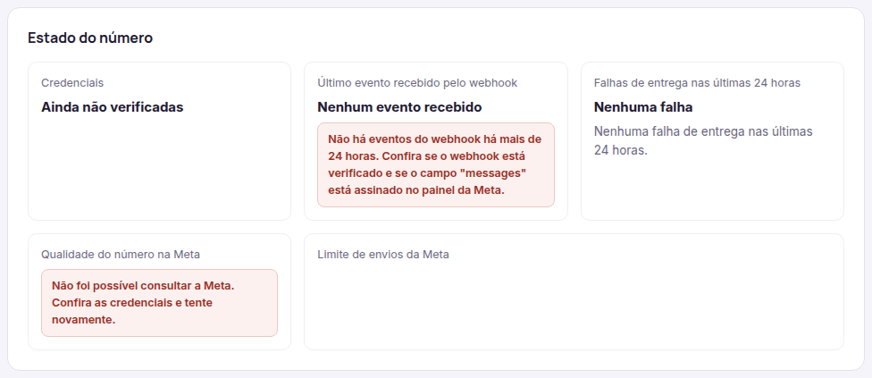
*Figura 8 – Seção Estado do número, antes da primeira conexão*

Depois de salvar, a seção **Estado do número** mostra:

| Item | O que mostra |
| --- | --- |
| Credenciais | Se estão válidas, com a data da última conferência, ou se o token venceu |
| Último evento recebido pelo webhook | Quando a Meta avisou o sistema pela última vez. Sem eventos há mais de 24 horas, aparece um alerta para conferir o webhook |
| Falhas de entrega nas últimas 24 horas | Mensagens que a Meta não conseguiu entregar |
| Qualidade do número na Meta | Alta, Média ou Baixa. Qualidade baixa pode levar a Meta a limitar os envios |
| Limite de envios da Meta | Quantas conversas a instituição pode iniciar por dia e quantas já usou. Acima de 80%, aparece um alerta |

Use o botão **Atualizar status da Meta**, na seção **Modelos de mensagem**, para consultar tudo de novo.

## Conferir os modelos

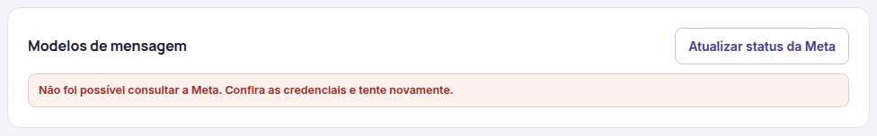
*Figura 9 – Seção Modelos de mensagem quando o sistema ainda não consegue consultar a Meta: aparece o aviso "Não foi possível consultar a Meta" e o botão Atualizar status da Meta*

Com as credenciais salvas e a Meta respondendo, cada modelo aparece com o nome e um status. Se aparecer o aviso da figura acima, confira as credenciais e clique em **Atualizar status da Meta**.

| Cor | Status | Significado |
| --- | --- | --- |
| Verde | Aprovado | A Meta aceitou o modelo |
| Amarelo | Em análise | A Meta ainda está analisando. Se a Meta devolver outro status, ele aparece também em amarelo, com o nome do status |
| Vermelho | Rejeitado | A Meta recusou o modelo |
| Vermelho | Não encontrado | Não existe modelo com esse nome e idioma na conta |

Clique em **Atualizar status da Meta** para ver a situação mais recente.

Se algum modelo não estiver aprovado, o painel avisa que os lembretes ou os avisos de cancelamento não serão enviados enquanto isso. Se estiver **Rejeitado**, revise o texto no Gerenciador do WhatsApp e envie de novo.

## Preencher a aba Privacidade

Na tela de WhatsApp, logo abaixo do título, existem duas abas: **Conexão** e **Privacidade**. Você esteve na aba Conexão até aqui. Abra agora a aba **Privacidade**.

Ela guarda os dados de quem responde, no PROCON, pelo tratamento dos dados pessoais dos cidadãos (a lei de proteção de dados, a LGPD). Esses dados aparecem em uma página pública de privacidade do sistema.

1. Clique na aba **Privacidade**.
2. Preencha o **Nome do controlador** (quem responde pelos dados na instituição).
3. Preencha o **E-mail de contato para pedidos do titular** (o e-mail onde o cidadão pede acesso, correção ou exclusão dos próprios dados).
4. Se quiser, preencha os demais campos, como o nome do encarregado.
5. Clique em **Salvar alterações**.

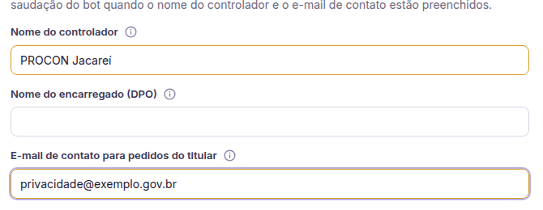
*Figura 10 – Aba Privacidade com o nome do controlador e o e-mail de contato (dados de exemplo)*

> **Atenção:** quando o nome do controlador e o e-mail de contato estão preenchidos, a saudação do chatbot passa a trazer o link "Saiba como tratamos seus dados". Sem esses dois campos, o link não aparece.

> **Dica:** esses dados mudam quando o PROCON assume o sistema. Por isso ficam no painel, e você pode alterá-los quando precisar.

## Ligar o aviso de cancelamento (opcional)

O aviso ao cidadão quando a equipe cancela um agendamento vem **desligado**.

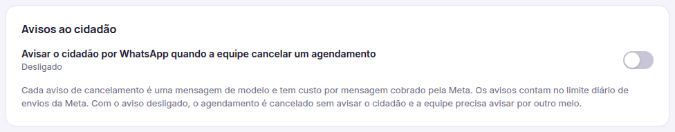
*Figura 11 – Seção Avisos ao cidadão, com o interruptor desligado*

1. Na seção **Avisos ao cidadão**, clique no interruptor.
2. O painel pede confirmação e lembra que cada aviso é cobrado pela Meta.
3. Clique em **Ligar aviso** para confirmar, ou em **Voltar** para desistir.

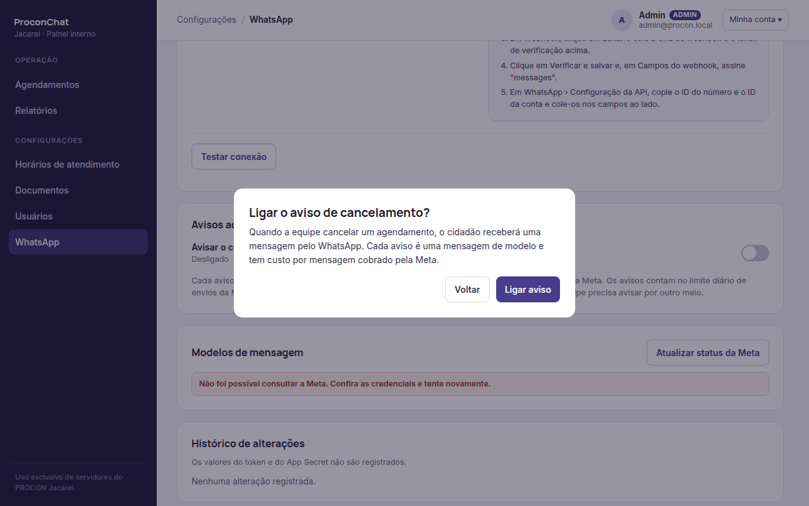
*Figura 12 – Confirmação para ligar o aviso de cancelamento*

A mudança vale na hora, sem precisar clicar em Salvar. Para desligar, o caminho é o mesmo, com outra confirmação. Com o aviso desligado, o agendamento é cancelado sem avisar o cidadão, e a equipe precisa avisar por outro meio.

## Ligar o lembrete ao cidadão (opcional)

O lembrete avisa o cidadão, algumas horas antes, do atendimento marcado. Ele vem **desligado** e é ligado em outra tela, **Horários de atendimento**, no menu lateral.

1. No menu lateral, clique em **Horários de atendimento**.
2. Procure a seção **Lembrete ao cidadão**.
3. Marque a caixa **Desativado**, no canto da seção. Ela passa a mostrar **Ativado**.

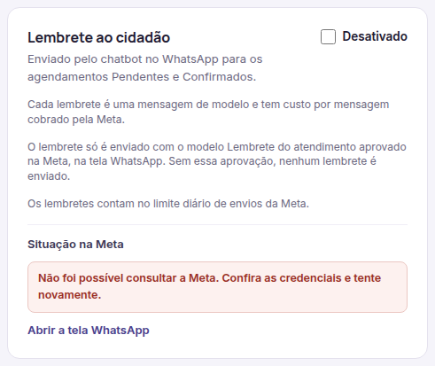
*Figura 13 – Seção Lembrete ao cidadão, ainda desligada*

4. O painel pede confirmação ("Ligar o lembrete?"). Clique em **Ligar lembrete**.

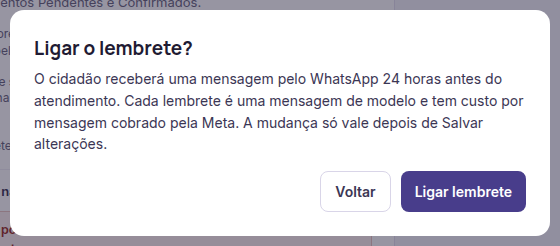
*Figura 14 – Confirmação para ligar o lembrete*

5. Em **Antecedência do lembrete**, escolha quantas horas antes do atendimento o cidadão será avisado. As opções são 2, 6, 12, 24 ou 48 horas.
6. Clique em **Salvar alterações**, no canto superior direito.

> **Atenção:** diferente do aviso de cancelamento, o lembrete só vale **depois de clicar em Salvar alterações**. Sem salvar, a mudança é perdida.

> **Atenção:** o lembrete só é enviado quando o modelo **Lembrete do atendimento** estiver **Aprovado** na Meta. Cada lembrete é uma mensagem de modelo, e a Meta pode cobrar por ele. Os lembretes também contam no limite diário de envios da Meta.

Quando o lembrete é ligado ou desligado e a mudança é salva, o fato entra no **Histórico de alterações** da tela de WhatsApp, com quem fez e quando. Para desligar, o caminho é o mesmo, com a confirmação "Desligar o lembrete?".

# 6. Pausar e retomar o atendimento

Use a pausa em emergências, por exemplo, quando o chatbot estiver passando uma informação errada ou o PROCON precisar parar o atendimento automático.

## Pausar

1. Na parte de cima da tela de WhatsApp, clique no interruptor **Pausar respostas automáticas**.
2. O painel pergunta se você quer pausar. Leia o aviso: o chatbot deixará de responder aos cidadãos até ser reativado.

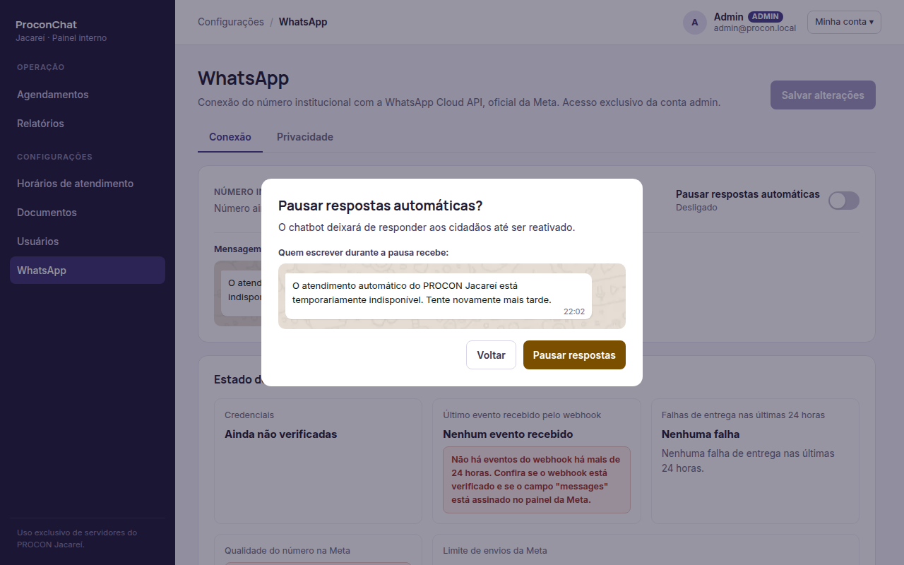
*Figura 15 – Confirmação para pausar as respostas, com a mensagem que o cidadão vai receber*

3. Clique em **Pausar respostas**.

A pausa vale **na hora**, sem precisar clicar em Salvar. Enquanto durar, quem escrever para o número recebe sempre esta mensagem:

> O atendimento automático do PROCON Jacareí está temporariamente indisponível. Tente novamente mais tarde.

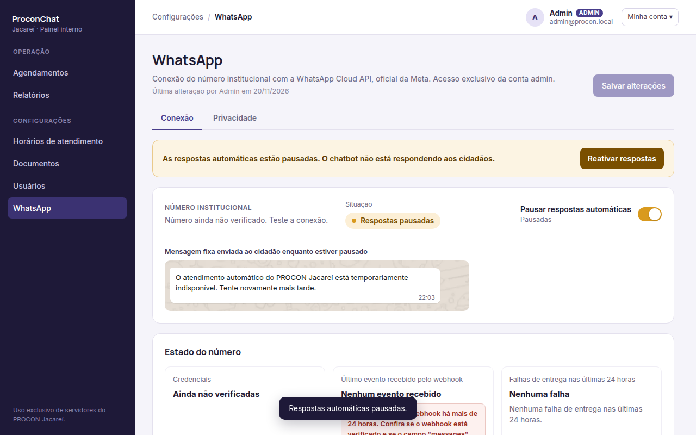
*Figura 16 – Atendimento pausado: uma faixa amarela no topo e a situação "Respostas pausadas"*

## Retomar

1. Clique em **Reativar respostas**, na faixa amarela do topo.
2. A volta é imediata e não pede confirmação.

> **Dica:** a pausa não apaga nada. As conversas e os agendamentos continuam guardados.

# 7. Problemas comuns

| O que aconteceu | O que fazer |
| --- | --- |
| O chatbot parou de responder de repente | Veja a situação na tela de WhatsApp. Se for "Credenciais inválidas" ou "Token inválido ou expirado", gere um novo token permanente (capítulo 3), clique em **Substituir**, teste e salve. Veja também se não ficou pausado |
| A situação mostra "Não verificado" | Clique em **Testar conexão** para o sistema conferir os dados com a Meta |
| O painel avisa que não há eventos do webhook há mais de 24 horas | Confira, no painel da Meta, se o webhook está verificado e se o campo **messages** está assinado |
| Os lembretes ou avisos não são enviados | Confira se o lembrete está ligado e salvo em **Horários de atendimento** (ele vem desligado) e se o aviso de cancelamento está ligado na tela de WhatsApp (também vem desligado). Veja o status dos modelos: eles precisam estar **Aprovado**. Veja também se a conta da Meta tem forma de pagamento |
| Esqueci a senha do Admin | Procure a equipe técnica responsável pelo sistema. Não há como redefinir pelo painel |
| O botão **WhatsApp** não aparece no menu | A conta usada não é a do Admin. Entre com a conta Admin |

> **Atenção:** se o problema não estiver nesta lista, não tente "forçar" o sistema. Procure a equipe técnica responsável pelo sistema e informe o que aparece na tela.
