<h1 id="sumario">Sumário</h1>
<div class="sumario">
<p class="cap"><a href="#s01">Antes de começar</a><span>3</span></p>
<p class="sec"><a href="#s01-01">Para quem é este manual</a><span>3</span></p>
<p class="sec"><a href="#s01-02">Como o painel está organizado</a><span>3</span></p>
<p class="sec"><a href="#s01-03">Salvar e descartar</a><span>3</span></p>
<p class="sec"><a href="#s01-04">Palavras que aparecem neste manual</a><span>4</span></p>
<p class="cap"><a href="#s02">1. Entrar e Minha conta</a><span>5</span></p>
<p class="sec"><a href="#s02-01">Entrar no painel</a><span>5</span></p>
<p class="sec"><a href="#s02-02">Conta sem nenhuma tela liberada</a><span>5</span></p>
<p class="sec"><a href="#s02-03">Menu Minha conta</a><span>6</span></p>
<p class="sec"><a href="#s02-04">Alterar a própria senha</a><span>6</span></p>
<p class="cap"><a href="#s03">2. Agendamentos</a><span>7</span></p>
<p class="sec"><a href="#s03-01">Situações de um agendamento</a><span>7</span></p>
<p class="sec"><a href="#s03-02">A lista</a><span>7</span></p>
<p class="sec"><a href="#s03-03">Calendário semanal</a><span>9</span></p>
<p class="cap"><a href="#s04">3. Detalhe do agendamento</a><span>11</span></p>
<p class="sec"><a href="#s04-01">O que a tela mostra</a><span>11</span></p>
<p class="sec"><a href="#s04-02">Ações</a><span>12</span></p>
<p class="sec"><a href="#s04-03">Cancelar um agendamento</a><span>14</span></p>
<p class="cap"><a href="#s05">4. Relatórios</a><span>15</span></p>
<p class="sec"><a href="#s05-01">Escolher o período</a><span>15</span></p>
<p class="sec"><a href="#s05-02">O que a tela mostra</a><span>15</span></p>
<p class="cap"><a href="#s06">5. Conteúdo do chatbot</a><span>17</span></p>
<p class="sec"><a href="#s06-01">Categorias</a><span>17</span></p>
<p class="sec"><a href="#s06-02">Perguntas</a><span>18</span></p>
<p class="sec"><a href="#s06-03">Ver como o cidadão recebe</a><span>19</span></p>
<p class="sec"><a href="#s06-04">Buscar, páginas e salvar</a><span>20</span></p>
<p class="cap"><a href="#s07">6. Horários de atendimento</a><span>21</span></p>
<p class="sec"><a href="#s07-01">Grade semanal</a><span>21</span></p>
<p class="sec"><a href="#s07-02">Janela de agendamento</a><span>22</span></p>
<p class="sec"><a href="#s07-03">Dados da unidade</a><span>22</span></p>
<p class="sec"><a href="#s07-04">Lembrete ao cidadão</a><span>22</span></p>
<p class="sec"><a href="#s07-05">Datas bloqueadas</a><span>23</span></p>
<p class="sec"><a href="#s07-06">Mudanças agendadas</a><span>23</span></p>
<p class="sec"><a href="#s07-07">Quando a mudança afeta agendamentos</a><span>23</span></p>
<p class="cap"><a href="#s08">7. Documentos</a><span>24</span></p>
<p class="cap"><a href="#s09">8. Usuários</a><span>25</span></p>
<p class="sec"><a href="#s09-01">Criar uma conta</a><span>26</span></p>
<p class="sec"><a href="#s09-02">Marcar as permissões</a><span>27</span></p>
<p class="sec"><a href="#s09-03">Redefinir a senha de uma conta</a><span>27</span></p>
<p class="sec"><a href="#s09-04">Desativar e reativar uma conta</a><span>28</span></p>
<p class="sec"><a href="#s09-05">Regras de segurança</a><span>29</span></p>
<p class="cap"><a href="#s10">9. WhatsApp</a><span>30</span></p>
<p class="cap"><a href="#s11">10. Permissões</a><span>34</span></p>
<p class="cap"><a href="#s12">11. Sugestões de combinações</a><span>35</span></p>
<p class="cap"><a href="#s13">Apêndice A. Redefinir a senha do Admin no servidor</a><span>37</span></p>
<p class="sec"><a href="#s13-01">Antes de começar</a><span>37</span></p>
<p class="sec"><a href="#s13-02">Passo a passo</a><span>37</span></p>
<p class="sec"><a href="#s13-03">Se o script falhar</a><span>38</span></p>
<p class="sec"><a href="#s13-04">Sem o script</a><span>38</span></p>
</div>

<h1 id="s01">Antes de começar</h1>

<h2 id="s01-01">Para quem é este manual</h2>

Este manual é para a equipe do PROCON Jacareí que usa o painel do ProconChat no dia a dia. Você não precisa saber nada de informática. Ele explica, tela por tela, o que cada uma mostra e o que dá para fazer nela, e diz o que cada permissão libera.

O painel é o site interno do PROCON. Nele a equipe acompanha os agendamentos que o chatbot cria no WhatsApp, cuida do conteúdo que o chatbot responde e configura o atendimento presencial.

> **Atenção:** os nomes de botões, campos e mensagens estão escritos neste manual exatamente como aparecem na tela, em **negrito**. Se algo na sua tela estiver diferente, avise a equipe técnica.

<h2 id="s01-02">Como o painel está organizado</h2>

O menu fica na lateral esquerda e tem três grupos:

| Grupo | Telas |
| --- | --- |
| Operação | Agendamentos e Relatórios |
| Chatbot | Conteúdo |
| Configurações | Horários de atendimento, Documentos, Usuários e WhatsApp |

Cada pessoa vê no menu só as telas que a sua conta pode usar. Por isso o menu de uma colega pode ser diferente do seu. O que cada conta pode usar depende das **permissões** marcadas para ela (veja o capítulo 10).

<h2 id="s01-03">Salvar e descartar</h2>

Nas telas de configuração (Conteúdo, Horários de atendimento, Documentos, Usuários e WhatsApp), nada vale na hora. As mudanças ficam **pendentes** até você clicar em **Salvar alterações**. Enquanto houver mudanças pendentes, aparece o aviso "N alterações não salvas". O botão **Descartar** desfaz tudo o que ainda não foi salvo.

Nas ações sobre um agendamento, como assumir ou cancelar, o painel pede uma confirmação e a ação vale na hora. Em Conteúdo (ao fechar o formulário de uma pergunta) e em Horários de atendimento (ao trocar de configuração), o painel também pergunta antes de descartar o que não foi salvo.

> **Atenção:** nada é excluído no painel. Categorias, perguntas e contas são apenas **ativadas** ou **desativadas**, para que o histórico continue completo.

<h2 id="s01-04">Palavras que aparecem neste manual</h2>

| Palavra | O que significa |
| --- | --- |
| Painel | O site interno do PROCON, usado pela equipe |
| Chatbot | O atendente automático que conversa com o cidadão pelo WhatsApp |
| Conta | O acesso de uma pessoa ao painel (e-mail e senha) |
| Admin | A conta principal do sistema, que tem todas as permissões |
| Permissão | Uma autorização que libera uma parte do painel para uma conta |
| Agendamento | Um atendimento presencial marcado pelo cidadão no chatbot |
| Protocolo | O código do agendamento, que o cidadão recebe no WhatsApp |
| Titular | A pessoa que fez a reclamação ou a dúvida e marcou o atendimento |
| Representante | A pessoa que comparece no lugar do titular |
| Responsável | O funcionário que assumiu o agendamento |
| Assumir | Tornar-se o responsável por um agendamento |
| Janela de agendamento | Quantos dias à frente o chatbot oferece horários |
| Modelo de mensagem | Um texto pronto, aprovado pela Meta (a empresa dona do WhatsApp), usado quando o sistema escreve primeiro ao cidadão |
| Anonimizar | Apagar de forma definitiva o que identifica a pessoa, como nome, CPF e telefone |
| Controlador e encarregado (DPO) | Quem decide o que se faz com os dados pessoais dos cidadãos, e a pessoa indicada para atender os cidadãos sobre esse assunto |
| ID do número e ID da conta | Códigos só de números que identificam o número e a conta do WhatsApp Business do PROCON na Meta |
| Token e App Secret | Códigos secretos que dão ao sistema permissão para usar o WhatsApp |

<h1 id="s02">1. Entrar e Minha conta</h1>

<h2 id="s02-01">Entrar no painel</h2>

1. Abra o endereço do painel no navegador.
2. Digite o seu **E-mail** e a sua **Senha**.
3. Clique em **Entrar**.

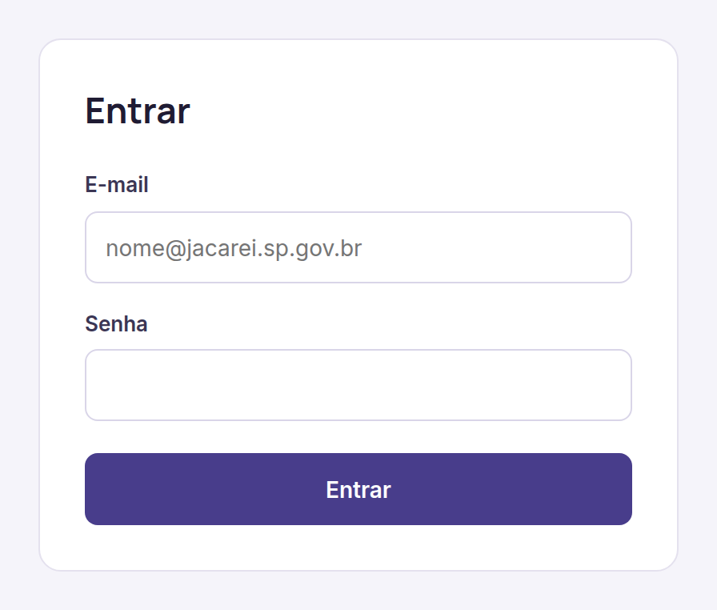
*Figura 1 – Tela de entrada do painel*

Se o e-mail ou a senha estiverem errados, aparece "E-mail ou senha incorretos.". Depois de várias tentativas sem sucesso, aparece "Muitas tentativas sem sucesso. Aguarde alguns minutos e tente de novo.". Espere um pouco e tente de novo.

Não existe "Esqueci minha senha". Se você esqueceu a sua, peça para redefinir a alguém que tenha a permissão **Gerenciar usuários** e também todas as permissões da sua conta, normalmente a conta Admin (capítulo 8). Se quem esqueceu foi o Admin, quem redefine é a equipe técnica (Apêndice A, só para a equipe técnica).

<h2 id="s02-02">Conta sem nenhuma tela liberada</h2>

Uma conta nova nasce sem permissões. Quem entra com ela vê o aviso "Sua conta ainda não tem acesso a nenhuma tela". Peça a alguém com a permissão **Gerenciar usuários** que libere as telas de que você precisa e depois entre de novo. O botão **Voltar para o login** encerra essa sessão.

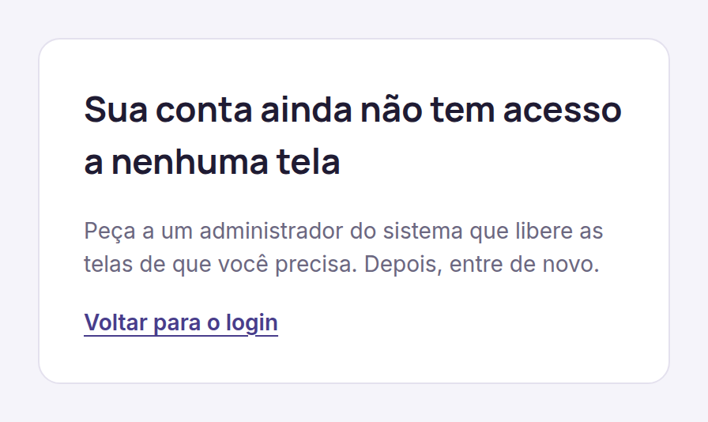
*Figura 2 – Aviso de conta sem nenhuma tela liberada*

<h2 id="s02-03">Menu Minha conta</h2>

No canto superior direito aparecem o seu nome e o seu e-mail. A conta Admin mostra também o selo **ADMIN**. Ao clicar em **Minha conta** abre um menu com duas opções: **Alterar minha senha** e **Sair**.

<h2 id="s02-04">Alterar a própria senha</h2>

1. Clique em **Minha conta** e depois em **Alterar minha senha**.
2. Digite a **Senha atual**.
3. Digite a **Nova senha** (mínimo de 8 caracteres) e repita em **Confirmar senha**.
4. Clique em **Salvar senha**.

A nova senha vale a partir do próximo acesso. Ao trocar a senha, as outras sessões abertas com a sua conta são encerradas, e a sessão atual continua.

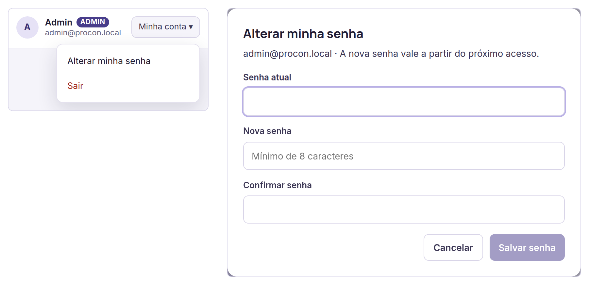
*Figura 3 – Menu Minha conta e janela Alterar minha senha*

<h1 id="s03">2. Agendamentos</h1>

A tela **Agendamentos** mostra os atendimentos presenciais criados pelo chatbot. Quem cria os agendamentos é sempre o chatbot: o painel não cria. Para mudar a data, quem remarca é o próprio cidadão, no chatbot.

**Quem usa:** quem tem a permissão **Ver agendamentos** consulta a tela. Quem tem **Gerenciar agendamentos** também pode agir sobre os agendamentos.

<h2 id="s03-01">Situações de um agendamento</h2>

| Situação | O que significa |
| --- | --- |
| Pendente | O chatbot criou o agendamento e ninguém assumiu ainda |
| Confirmado | Um funcionário assumiu o agendamento, ou ele foi entregue a alguém |
| Atendido | O cidadão foi atendido |
| Não compareceu | O horário passou e o cidadão não veio |
| Cancelado | Foi cancelado pelo cidadão, no chatbot, ou pela equipe, no painel |

<h2 id="s03-02">A lista</h2>

A tela abre na visão **Lista**. Cada linha mostra o protocolo, o titular (com o CPF parcialmente escondido), a categoria e a pergunta de origem, a data e a hora, o responsável e a situação. Na linha de um agendamento Pendente aparece o botão **Assumir**, para quem tem a permissão de gerenciar.

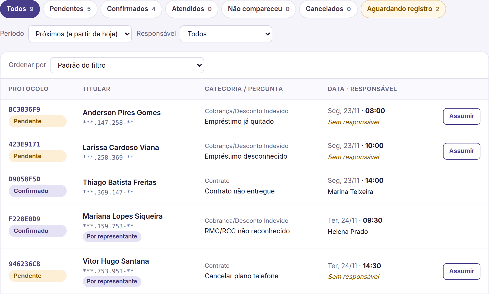
*Figura 4 – Lista de agendamentos*

Para achar um agendamento, use os recursos do topo da tela:

- **Buscar:** digite o nome do titular, o protocolo ou o CPF completo (os 11 números). A busca olha todos os períodos, situações e responsáveis. Com um único resultado, a tecla Enter abre o agendamento. É o recurso ideal para a recepção, quando o cidadão chega.
- **Situação:** os botões **Todos**, **Pendentes**, **Confirmados**, **Atendidos**, **Não compareceu**, **Cancelados** e **Aguardando registro**, cada um com a contagem. **Aguardando registro** reúne os agendamentos confirmados cujo horário já passou sem que ninguém tenha registrado se o cidadão foi atendido ou faltou.
- **Período:** **Todos**, **Hoje**, **Esta semana**, **Próximos (a partir de hoje)** ou **Anteriores a hoje**.
- **Responsável:** **Todos**, **Sem responsável**, **Atribuídos a mim** ou um funcionário em particular.

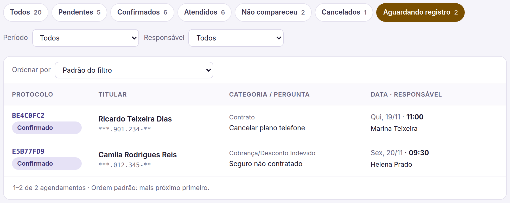
*Figura 5 – Agendamentos aguardando registro, com o período em Todos*

> **Dica:** os títulos Titular, Data e hora, Responsável e Status podem ser clicados para ordenar a lista. Cada página mostra 20 agendamentos, e os botões **Anterior** e **Próxima** passam de página.

<h2 id="s03-03">Calendário semanal</h2>

O botão **Calendário semanal** troca a lista por uma grade da semana, com um quadro para cada agendamento, colorido pela situação. Nos horários sem agendamento aparece quantas vagas ainda estão livres. Os botões de seta passam para a semana anterior ou para a próxima, e **Esta semana** volta para a semana de hoje. Clicar num agendamento abre o detalhe dele.

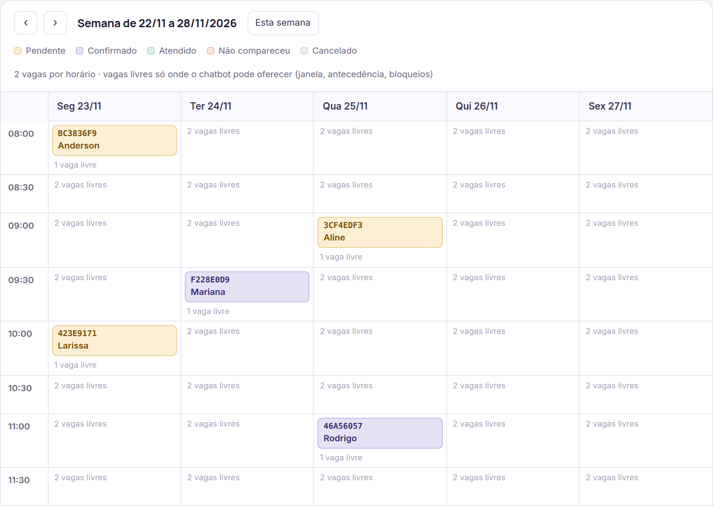
*Figura 6 – Calendário semanal de agendamentos*

<h1 id="s04">3. Detalhe do agendamento</h1>

Ao clicar num agendamento da lista ou do calendário, abre a tela de detalhe. O botão **Voltar para Agendamentos** leva de volta à lista.

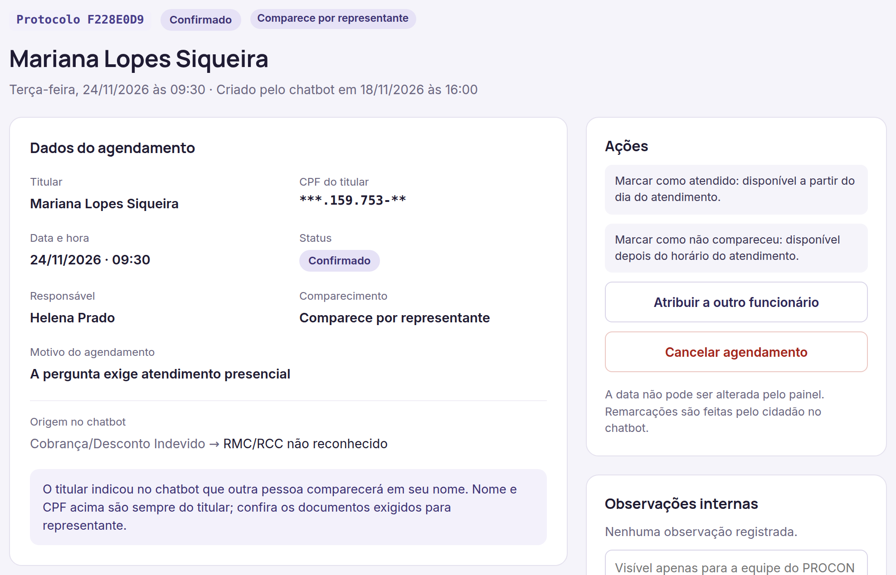
*Figura 7 – Detalhe de um agendamento confirmado, com comparecimento por representante*

<h2 id="s04-01">O que a tela mostra</h2>

- **Dados do agendamento:** titular, CPF do titular (parcialmente escondido), data e hora, situação, responsável, quem comparece (o titular ou um representante), o motivo do agendamento e de onde o cidadão veio no chatbot. Quando comparece um representante, nome e CPF continuam sendo do titular, e a tela lembra de conferir os documentos exigidos do representante.
- **Documentos solicitados pelo chatbot:** a lista que o cidadão recebeu no momento do agendamento. Se a configuração de documentos mudar depois, esta lista não muda, e a tela avisa quando ela é diferente da configuração atual.
- **Linha do tempo da conversa de origem:** os passos que o cidadão percorreu no chatbot. O sistema guarda só os passos, não o texto que o cidadão digitou.
- **Histórico:** tudo o que aconteceu com o agendamento, do mais recente ao mais antigo (criado, assumido, atribuído, remarcado, cancelado, lembrete enviado e outros), com quem fez e quando.
- **Observações internas:** anotações visíveis só para a equipe do PROCON, com o nome de quem escreveu e a data.

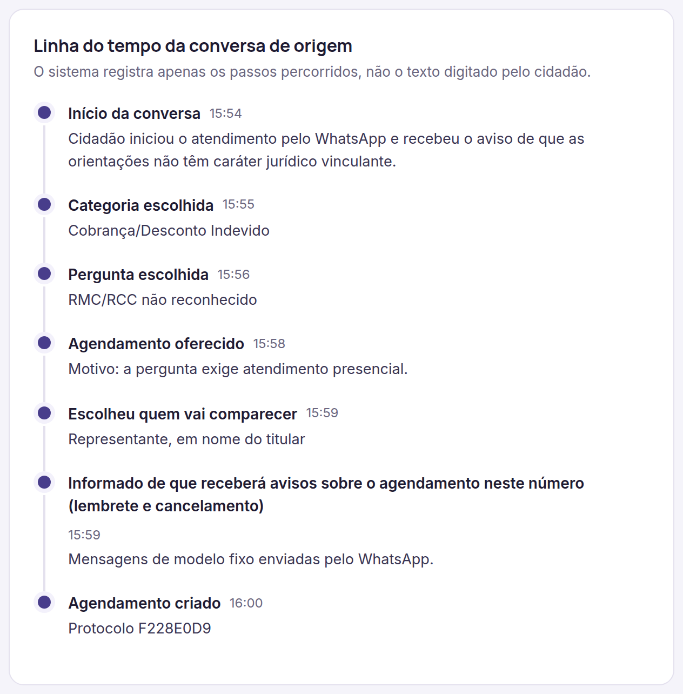
*Figura 8 – Linha do tempo da conversa de origem*

> **Atenção:** abrir a conversa completa a partir do detalhe ainda não está disponível.

<h2 id="s04-02">Ações</h2>

Quem tem **Gerenciar agendamentos** vê o quadro **Ações**. Quem só tem **Ver agendamentos** vê a mensagem "Sua conta pode apenas visualizar agendamentos.". As ações mudam conforme a situação do agendamento.

| Ação | Quando aparece | O que acontece |
| --- | --- | --- |
| Assumir para mim | Agendamento Pendente | Vira Confirmado, com você como responsável |
| Atribuir a outro funcionário | Pendente ou Confirmado | Você escolhe o funcionário responsável, e o agendamento vira Confirmado |
| Marcar como atendido | Pendente ou Confirmado, a partir do dia do atendimento | Vira Atendido |
| Marcar como não compareceu | Pendente ou Confirmado, depois do horário do atendimento | Vira Não compareceu |
| Corrigir registro | Atendido ou Não compareceu | Volta ao estado anterior ao registro (Pendente ou Confirmado) |
| Cancelar agendamento | Pendente ou Confirmado, antes do horário do atendimento | Abre a janela de cancelamento |

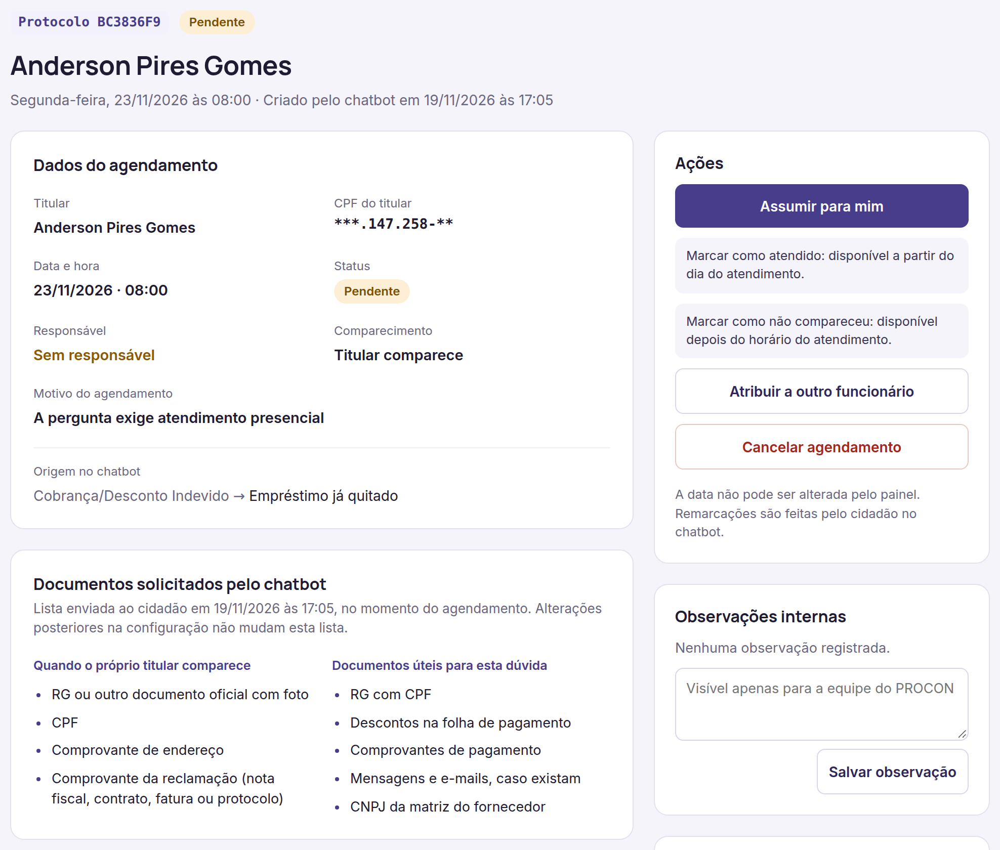
*Figura 9 – Detalhe de um agendamento pendente, com as ações disponíveis*

Antes do dia do atendimento, o painel mostra "Marcar como atendido: disponível a partir do dia do atendimento." no lugar do botão. O mesmo vale para "Marcar como não compareceu", que só fica disponível depois do horário. Num agendamento Pendente, marcar como atendido ou como não compareceu também faz de você o responsável.

<h2 id="s04-03">Cancelar um agendamento</h2>

Ao clicar em **Cancelar agendamento**, escolha o **Motivo do cancelamento**: **Unidade fechada nesta data**, **A pedido do cidadão**, **Agendamento duplicado** ou **Outro motivo**. Você pode escrever uma **Observação interna**, que não é enviada ao cidadão. Depois de confirmar, o horário volta a ficar disponível no chatbot, e a ação não pode ser desfeita.

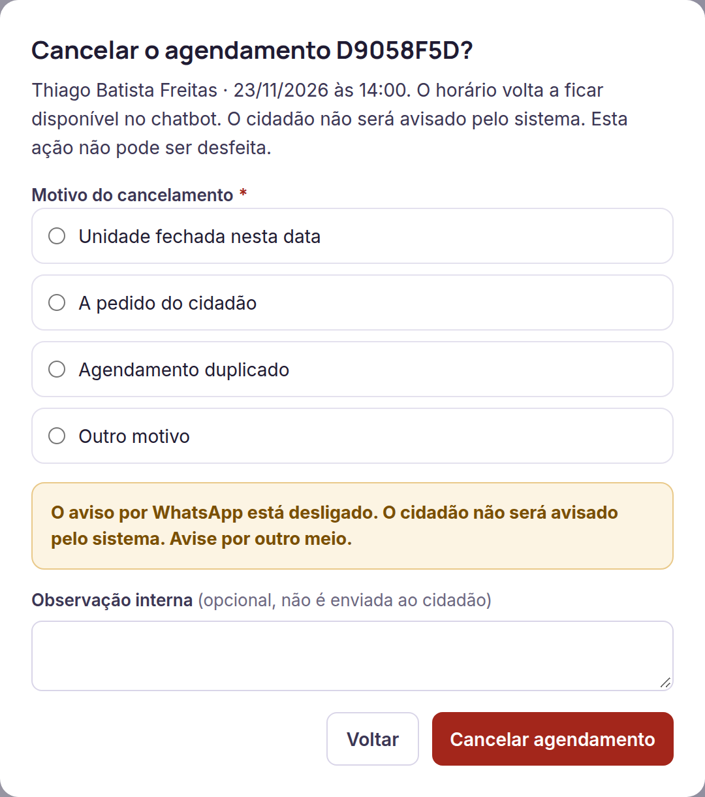
*Figura 10 – Janela de cancelamento do agendamento*

O aviso ao cidadão por WhatsApp é opcional e é ligado ou desligado pelo Admin na tela **WhatsApp** (capítulo 9). Ele começa desligado. Com o aviso desligado, a janela diz "O aviso por WhatsApp está desligado. O cidadão não será avisado pelo sistema. Avise por outro meio.", e quem cancela precisa avisar o cidadão por telefone ou outro meio. Depois do horário do atendimento não é possível cancelar: registre o caso como atendido ou como não compareceu.

<h1 id="s05">4. Relatórios</h1>

A tela **Relatórios** mostra números do uso do chatbot e dos agendamentos presenciais.

**Quem usa:** quem tem a permissão **Ver relatórios**.

<h2 id="s05-01">Escolher o período</h2>

No topo, escolha o período: **Últimos 7 dias**, **Últimos 30 dias**, **Últimos 90 dias**, **Mês atual**, **Mês anterior** ou **Personalizado**. No período personalizado, preencha as datas **De** e **até**. Todos os números da tela passam a valer para o período escolhido.

<h2 id="s05-02">O que a tela mostra</h2>

- **Conversas no período:** quantas conversas o chatbot teve, a média por dia e quantos agendamentos foram criados.
- **Desfecho das conversas:** como cada conversa terminou, com a quantidade e a porcentagem. Cada conversa tem um único desfecho, e o total fecha em 100%. Passe o mouse sobre o ícone de informação ao lado de cada desfecho para ler a definição dele.
- **Categorias mais usadas** e **Perguntas mais usadas:** quantas conversas escolheram cada categoria e cada pergunta.
- **Resultado dos agendamentos:** a situação atual dos agendamentos cuja data de atendimento cai no período, e a **Taxa de não comparecimento**.

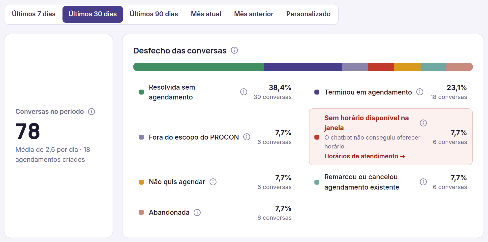
*Figura 11 – Tela de Relatórios, com período, conversas e desfechos*

Os desfechos possíveis são: **Resolvida sem agendamento**, **Terminou em agendamento**, **Fora do escopo do PROCON**, **Sem horário disponível na janela**, **Não quis agendar**, **Remarcou ou cancelou agendamento existente**, **Abandonada** (sem resposta por mais de 30 minutos) e **Em andamento** (conversas de hoje que ainda não terminaram, que só aparece se houver).

> **Dica:** quando aparece "Sem horário disponível na janela", o chatbot não conseguiu oferecer horário. O atalho **Horários de atendimento →** leva à tela onde se ajusta a agenda.

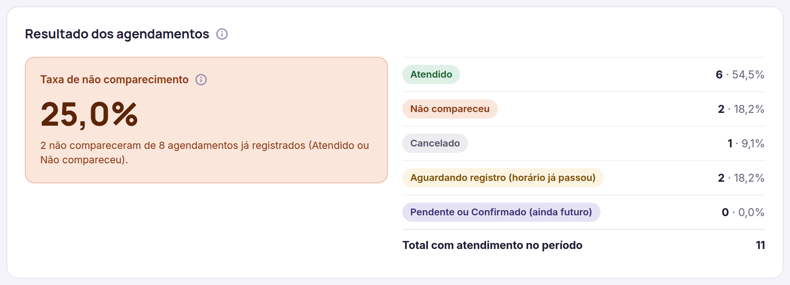
*Figura 12 – Resultado dos agendamentos e taxa de não comparecimento*

A **Taxa de não comparecimento** divide os que não compareceram pelos que já foram registrados (Atendido mais Não compareceu). Agendamentos cancelados, aguardando registro e futuros não entram na conta.

> **Atenção:** indicadores adicionais e a exportação dos relatórios ainda não estão disponíveis.

<h1 id="s06">5. Conteúdo do chatbot</h1>

A tela **Conteúdo** é onde a equipe mantém as categorias, perguntas e respostas que o cidadão navega no WhatsApp. A ordem das listas na tela é a ordem em que o cidadão vê.

**Quem usa:** quem tem a permissão **Gerenciar conteúdo do chatbot**.

No topo há um aviso fixo, que não pode ser editado: "Esta é uma orientação automatizada de caráter informativo. Ela não é vinculante e não substitui o atendimento jurídico ou administrativo formal do PROCON Jacareí." Esse aviso é enviado ao final de todas as respostas do chatbot.

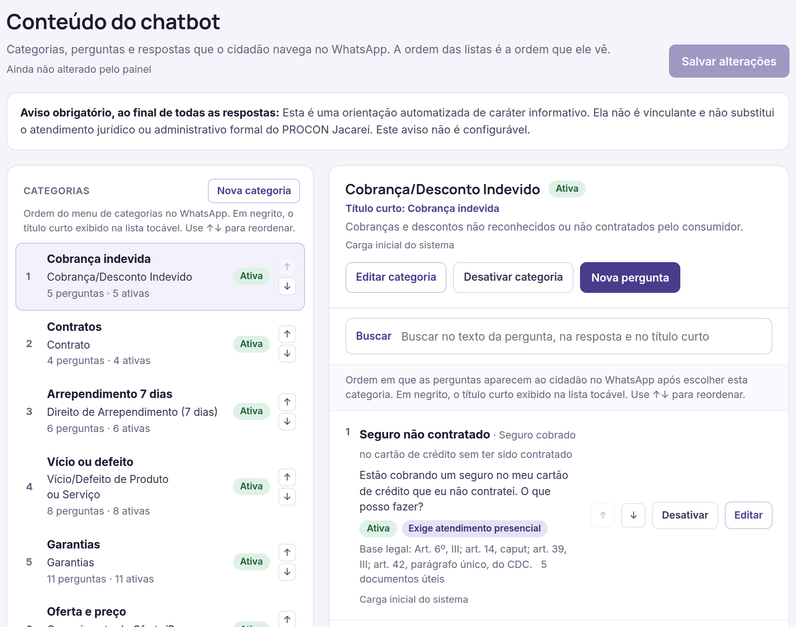
*Figura 13 – Categorias à esquerda e perguntas da categoria escolhida à direita*

<h2 id="s06-01">Categorias</h2>

A coluna da esquerda lista as categorias. Clique numa categoria para ver as perguntas dela.

- **Nova categoria** cria uma categoria, sempre no fim da lista. O formulário pede o título curto (até 24 caracteres, que é o limite das listas do WhatsApp), o nome da categoria e, se quiser, uma descrição.
- As setas ↑ e ↓ mudam a posição da categoria no menu do WhatsApp.
- **Editar categoria** e **Desativar categoria** (ou **Ativar categoria**) ficam no cabeçalho da categoria escolhida.
- Uma categoria ativa sem nenhuma pergunta ativa aparece como "Ativa · oculta no chatbot": o cidadão só vê categorias que têm ao menos uma pergunta ativa.

<h2 id="s06-02">Perguntas</h2>

A coluna da direita mostra as perguntas da categoria escolhida, com a posição, o título curto, o texto da pergunta, a situação (**Ativa** ou **Inativa**) e, quando existirem, os selos **Exige atendimento presencial** e **Fora do escopo do PROCON**.

- **Nova pergunta** abre o formulário numa janela lateral, com os campos de título curto, descrição curta, texto da pergunta, resposta oficial, base legal e documentos úteis para a dúvida. Os campos têm contador de caracteres. A partir de 1.000 caracteres na resposta aparece o alerta "Respostas longas ficam difíceis de ler no celular", que não impede de salvar.
- **Exige atendimento presencial:** o chatbot oferece o agendamento direto, sem perguntar se a dúvida foi resolvida.
- **Fora do escopo do PROCON:** a resposta orienta a procurar outro órgão e nunca oferece agendamento. Essa opção não pode ser marcada junto com a anterior.
- **Permitir complemento por IA nesta pergunta:** quando desligada, o chatbot envia só o texto oficial.
- **Editar** abre a pergunta para alteração. Para mudar o assunto de uma pergunta, desative-a e crie uma nova, para não alterar o histórico dos relatórios.
- **Desativar** (ou **Ativar**) liga ou desliga a pergunta no chatbot.
- Os botões **Cancelar** e **Salvar pergunta** ficam no rodapé da janela.

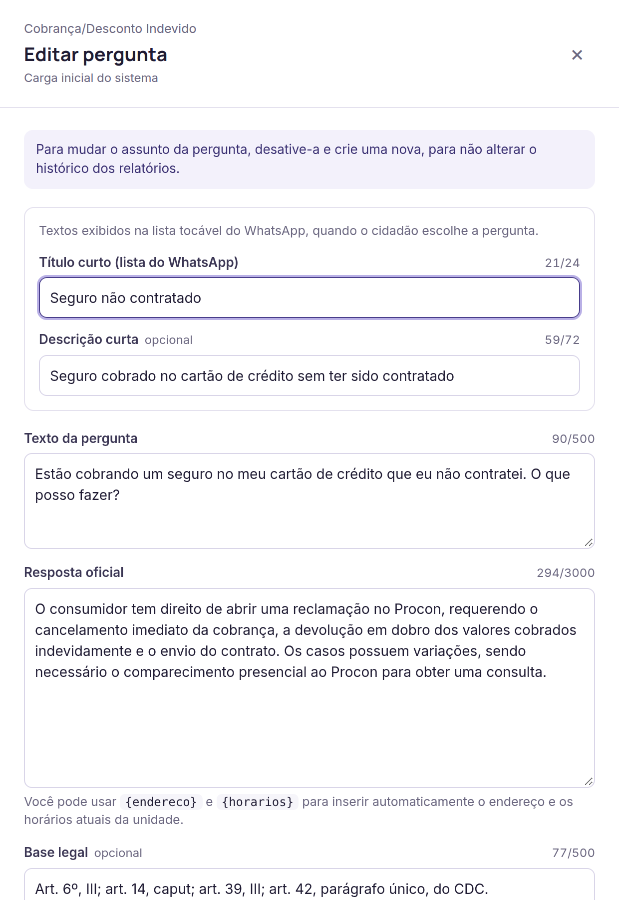
*Figura 14 – Formulário de edição de uma pergunta (a janela continua abaixo)*

<h2 id="s06-03">Ver como o cidadão recebe</h2>

O botão **Ver como o cidadão recebe**, dentro do formulário da pergunta, mostra uma prévia no estilo do WhatsApp com o que está no formulário, mesmo antes de salvar. Nada é gravado, e o texto da inteligência artificial é um exemplo, não uma resposta real.

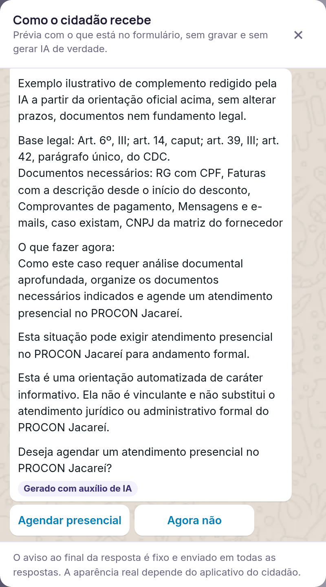
*Figura 15 – Prévia de como o cidadão recebe a resposta*

<h2 id="s06-04">Buscar, páginas e salvar</h2>

- **Buscar** procura no texto da pergunta, na resposta e no título curto, em todas as categorias.
- Quando uma lista tem mais de 10 itens ativos, o WhatsApp mostra a lista em páginas. A tela marca onde começa cada página com "Página N no WhatsApp". Listas curtas são mais fáceis para o cidadão.
- As mudanças só valem depois de **Salvar alterações**. Cada item com mudança pendente mostra o selo **Não salva** (item novo) ou **Alteração não salva** (item que já existia). Duas pessoas editando ao mesmo tempo: vale o último **Salvar alterações**.

<h1 id="s07">6. Horários de atendimento</h1>

A tela **Horários de atendimento** define os horários livres que o chatbot oferece ao cidadão para o atendimento presencial.

**Quem usa:** quem tem a permissão **Configurar atendimento presencial**.

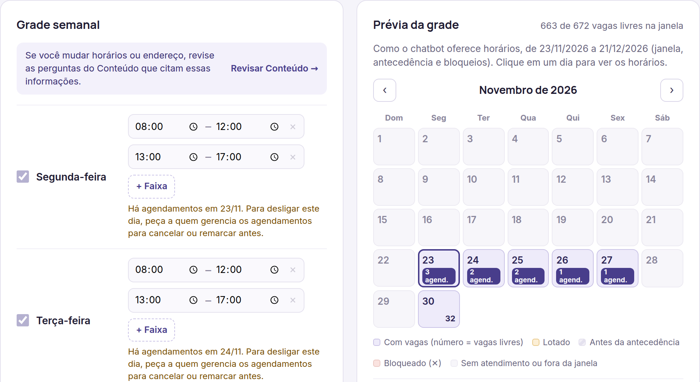
*Figura 16 – Grade semanal e prévia da grade*

<h2 id="s07-01">Grade semanal</h2>

Para cada dia da semana, marque a caixa do dia para ligar o atendimento e informe as faixas de horário, como 08:00 às 12:00 e 13:00 às 17:00. O botão **+ Faixa** acrescenta outra faixa no dia, e o × remove. Dois campos definem o tamanho dos horários: **Duração de cada atendimento** e **Vagas simultâneas por horário**.

A **Prévia da grade** mostra, num calendário, como o chatbot oferece os horários. Clique num dia para ver os horários dele e os agendamentos que já existem.

<h2 id="s07-02">Janela de agendamento</h2>

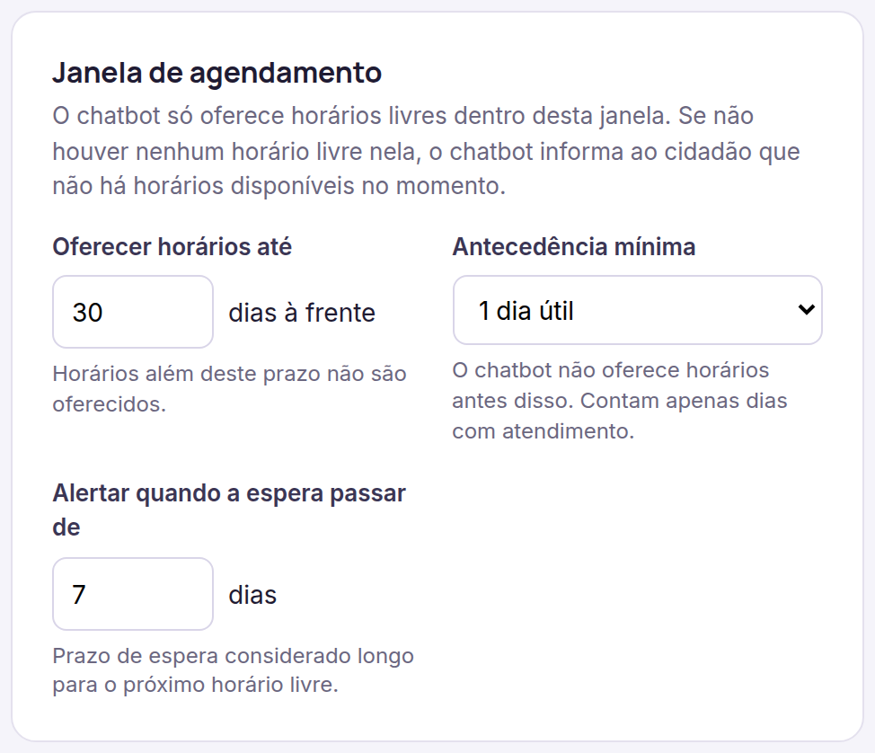
*Figura 17 – Janela de agendamento (o aviso do Dashboard citado na tela ainda não está disponível)*

- **Oferecer horários até:** quantos dias à frente o chatbot oferece horários. Se não houver horário livre nessa janela, o chatbot avisa o cidadão que não há horários disponíveis no momento.
- **Antecedência mínima:** de **Sem antecedência (mesmo dia)** a **5 dias úteis**. Contam só os dias com atendimento.
- **Alertar quando a espera passar de:** quantos dias de espera até o próximo horário livre são considerados demais. O aviso correspondente ainda não está disponível no painel.

<h2 id="s07-03">Dados da unidade</h2>

O **Endereço da unidade** é obrigatório e aparece nas mensagens do chatbot, como a confirmação do agendamento. O **Complemento ou referência** é opcional.

<h2 id="s07-04">Lembrete ao cidadão</h2>

Com a opção **Enviar lembrete ao cidadão** ligada, o chatbot manda um lembrete pelo WhatsApp aos agendamentos Pendentes e Confirmados, com a antecedência escolhida em **Antecedência do lembrete**. O texto é fixo e aparece na **Prévia da mensagem**. Cada lembrete é uma mensagem de modelo e tem custo por mensagem cobrado pela Meta, por isso o painel pede uma confirmação ao ligar e ao desligar. O lembrete só é enviado depois que a Meta aprova o modelo, o que é acompanhado na tela **WhatsApp**, só da conta Admin.

<h2 id="s07-05">Datas bloqueadas</h2>

Use para feriados e pontos facultativos. Escolha a **Data**, escreva a **Descrição** e clique em **Adicionar**. O chatbot não oferece horários nos dias bloqueados. **Remover** tira o bloqueio. Hoje só é possível bloquear o dia inteiro: bloquear apenas um período do dia ainda não está disponível.

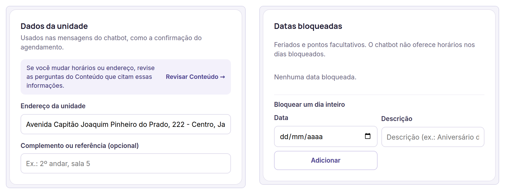
*Figura 18 – Dados da unidade e datas bloqueadas*

<h2 id="s07-06">Mudanças agendadas</h2>

O campo **Valer a partir de** permite preparar uma nova configuração para uma data futura (a partir de amanhã). A lista **Mudanças agendadas** mostra as que existem, com as opções **Editar** e **Cancelar mudança**, e **Voltar à configuração de hoje** retorna à configuração atual.

<h2 id="s07-07">Quando a mudança afeta agendamentos</h2>

O painel não deixa salvar uma mudança que deixaria agendamentos existentes fora da agenda. Dias com agendamentos aparecem marcados na prévia, e a tela mostra avisos como "Há agendamentos em 23/11. Para desligar este dia, peça a quem gerencia os agendamentos para cancelar ou remarcar antes.". Quando uma alteração afeta agendamentos, a lista **Esta alteração afeta N agendamentos** mostra quais são, e **Salvar alterações** fica desabilitado até que alguém com a permissão **Gerenciar agendamentos** cancele ou remarque esses agendamentos.

> **Atenção:** ainda não está disponível uma forma de resolver isso pela própria tela de Horários.

Quando você muda horários ou endereço, o painel lembra de revisar as perguntas do Conteúdo que citam essas informações, com o atalho **Revisar Conteúdo →**.

<h1 id="s08">7. Documentos</h1>

A tela **Documentos** define as listas de documentos que o chatbot envia ao cidadão ao criar o agendamento. Há duas listas: **Quando o próprio titular comparece** e **Quando um representante comparece em nome do titular**. Em cada caso, o chatbot soma a lista aos documentos úteis da pergunta que o cidadão fez.

**Quem usa:** quem tem a permissão **Configurar documentos para atendimento presencial**.

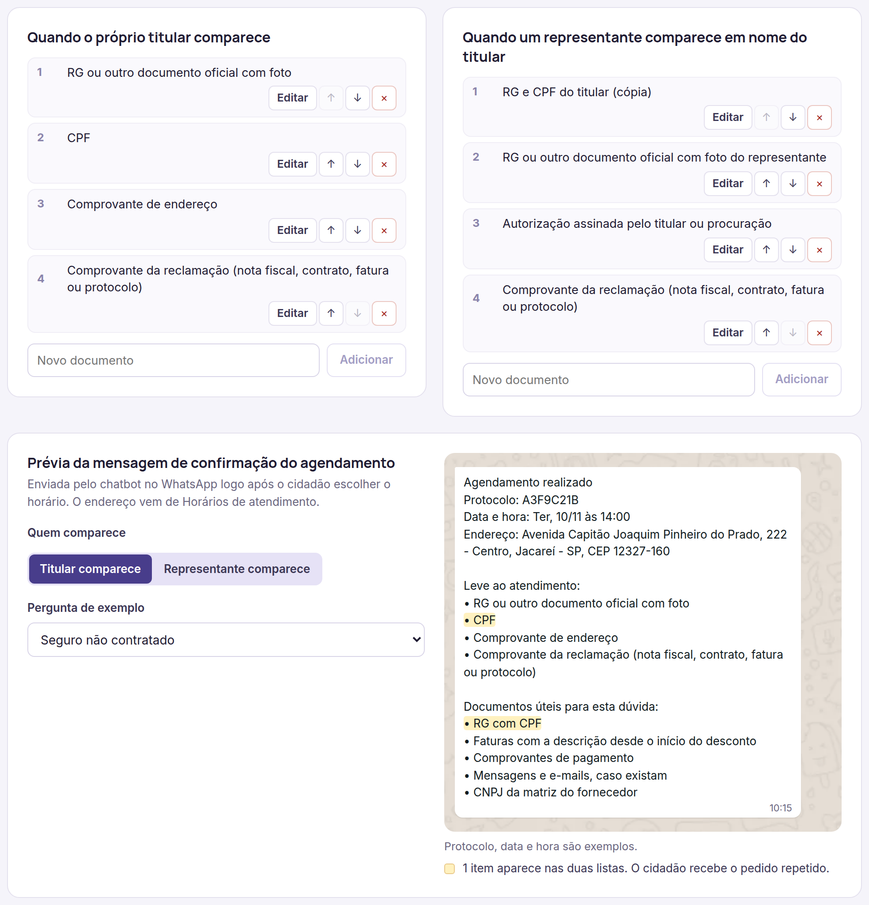
*Figura 19 – Listas de documentos e prévia da mensagem de confirmação*

- Para acrescentar um documento, escreva no campo **Novo documento** e clique em **Adicionar**.
- **Editar** altera o texto de um item (Enter confirma e Esc cancela). O botão × (**Remover**) tira o item da lista.
- As setas ↑ e ↓ mudam a ordem.
- Um documento repetido na mesma lista não é aceito: "Esse documento já está na lista.".
- Se uma lista ficar vazia, a tela avisa que o cidadão pode chegar sem o necessário para o atendimento.

A **Prévia da mensagem de confirmação do agendamento** mostra como o cidadão recebe a mensagem no WhatsApp, para o titular ou para o representante, com uma pergunta de exemplo. A prévia já inclui as alterações não salvas. Protocolo, data e hora são exemplos.

> **Atenção:** as alterações valem só para os próximos agendamentos. Os agendamentos já criados mantêm a lista que foi enviada ao cidadão na época.

<h1 id="s09">8. Usuários</h1>

A tela **Usuários** mostra todas as contas do painel e permite criar contas, marcar as permissões de cada uma, redefinir senhas e desativar contas.

**Quem usa:** quem tem a permissão **Gerenciar usuários**.

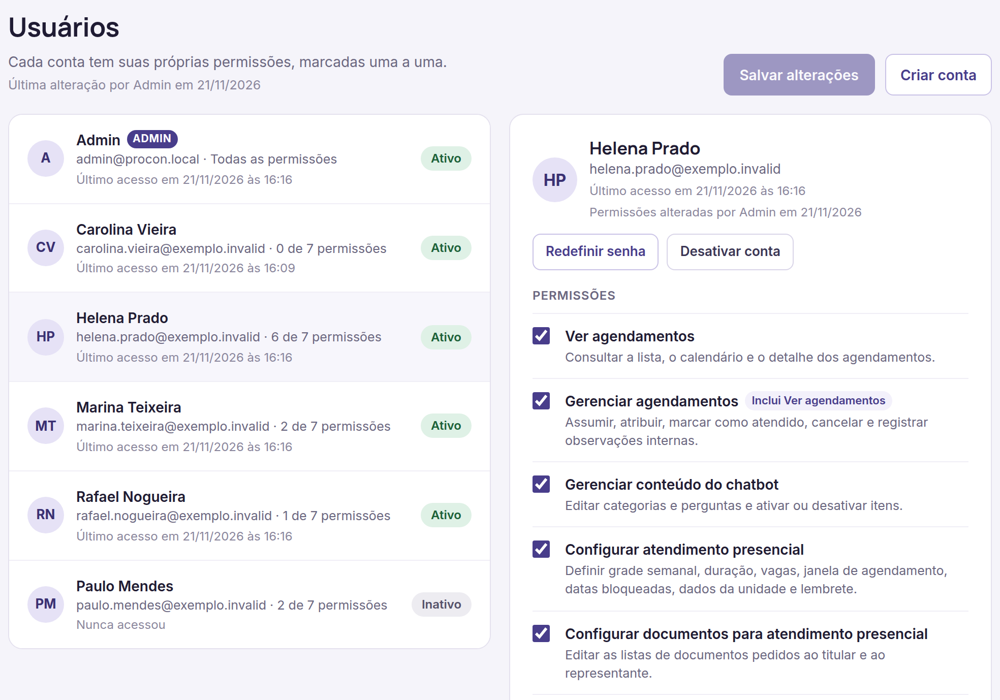
*Figura 20 – Lista de contas e painel da conta selecionada*

A lista mostra, para cada conta, o nome, o e-mail, quantas permissões ela tem, o último acesso (ou "Nunca acessou") e se está **Ativo** ou **Inativo**. A conta Admin leva o selo **ADMIN** e aparece como "Todas as permissões". Ao clicar numa conta, o painel da direita mostra os detalhes e as permissões dela.

A tela mostra só as permissões das telas que já estão disponíveis no painel. As demais permissões da tabela do capítulo 10 aparecem aqui quando a tela delas ficar disponível.

<h2 id="s09-01">Criar uma conta</h2>

1. Clique em **Criar conta**.
2. Preencha o **Nome**, o **E-mail** (não pode repetir o de outra conta) e a **Senha inicial** (mínimo de 8 caracteres).
3. Clique em **Criar conta**.

A conta é criada sem nenhuma permissão. Informe a senha inicial pessoalmente à pessoa, porque o sistema não envia e-mails. Depois, marque as permissões dela.

<h2 id="s09-02">Marcar as permissões</h2>

Clique na conta e marque ou desmarque as permissões, uma a uma. **Gerenciar agendamentos** inclui **Ver agendamentos**: marcar a primeira marca a segunda. Não existem perfis nem cargos: cada conta é montada marcando as permissões que ela precisa (veja o capítulo 11 para sugestões). As mudanças só valem depois de **Salvar alterações**, e a conta passa a mostrar "Permissões alteradas por [nome] em [data]".

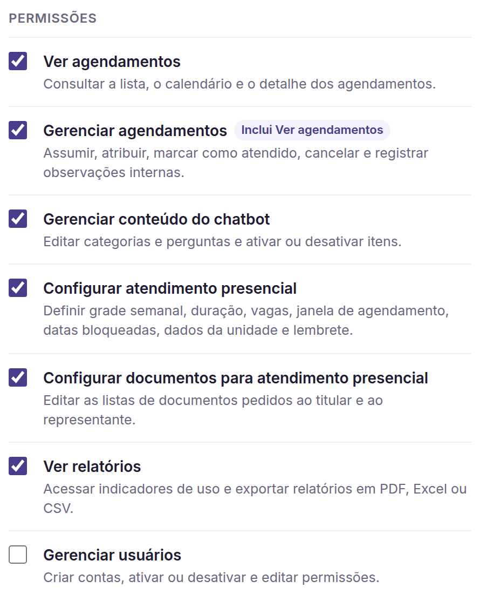
*Figura 21 – Permissões marcadas em uma conta*

A descrição de **Ver relatórios** fala em exportação, mas a exportação ainda não está disponível.

<h2 id="s09-03">Redefinir a senha de uma conta</h2>

Clique na conta e em **Redefinir senha**. Defina a **Nova senha inicial**, repita em **Confirmar senha** e clique em **Redefinir senha**. A senha anterior deixa de funcionar na hora, e a nova deve ser informada pessoalmente à pessoa.

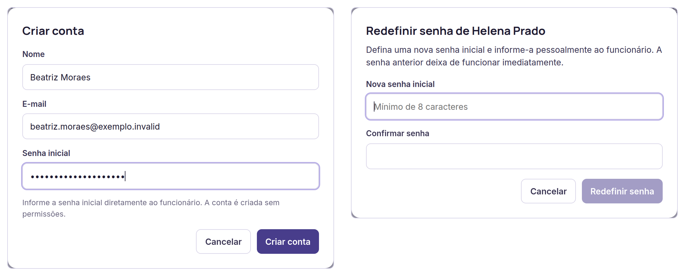
*Figura 22 – Janelas Criar conta e Redefinir senha*

<h2 id="s09-04">Desativar e reativar uma conta</h2>

**Desativar conta** impede a pessoa de entrar. **Reativar conta** devolve o acesso. As contas não são excluídas, para preservar quem escreveu cada observação e cada registro.

Se a conta é responsável por agendamentos futuros, ao desativá-la, ou ao tirar dela a permissão **Gerenciar agendamentos**, abre a janela "Esta conta é responsável por N agendamentos futuros". Escolha entre **Voltar para Pendente sem responsável** ou **Atribuir a outro funcionário** (entre as contas ativas que gerenciam agendamentos) e clique em **Continuar**. A mudança só vale ao salvar e fica registrada no histórico de cada agendamento.

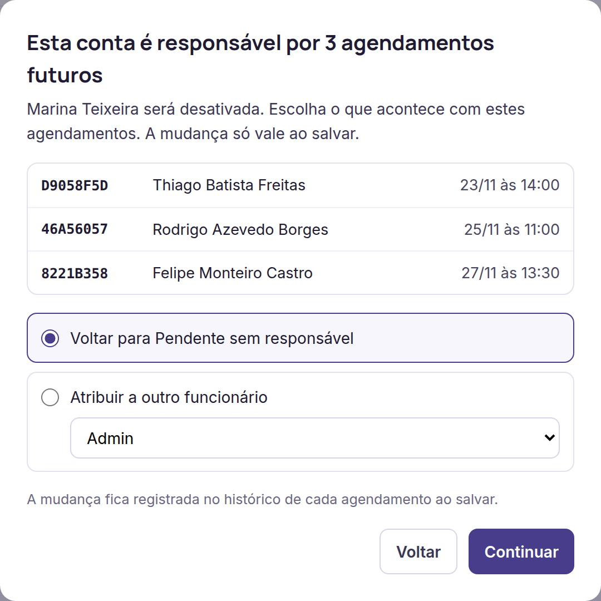
*Figura 23 – Janela de agendamentos futuros da conta*

<h2 id="s09-05">Regras de segurança</h2>

Estas regras evitam que alguém aumente o próprio acesso.

1. **Ninguém altera a própria conta.** Aparece "Você não pode alterar a própria conta. Peça a outro usuário com a permissão Gerenciar usuários.". Para trocar a própria senha, use **Alterar minha senha**.
2. **Só se concede ou remove o que você mesmo tem.** As permissões que você não tem aparecem bloqueadas, com o aviso "Você não possui esta permissão".
3. **Só se redefine a senha ou se desativa uma conta cujas permissões você tem por completo.** Caso contrário, os botões ficam bloqueados com o aviso "Esta conta tem permissões que você não possui".
4. **A conta Admin não pode ser alterada pelo painel:** não pode ser desativada, não perde permissões e ninguém redefine a senha dela por aqui. Se o Admin esquecer a senha, a redefinição é feita pela equipe técnica diretamente no servidor.

<h1 id="s10">9. WhatsApp</h1>

A tela **WhatsApp** mostra a conexão do número do PROCON com o WhatsApp e permite pausar o chatbot.

**Quem usa:** só a conta Admin. Se o seu menu não mostra **WhatsApp**, você não está usando a conta Admin.

> **Atenção:** este manual apresenta a tela. O passo a passo para conectar o número pela primeira vez está no Guia de configuração do atendimento por WhatsApp, que acompanha este manual.

A tela tem duas abas: **Conexão** e **Privacidade**.

### Aba Conexão

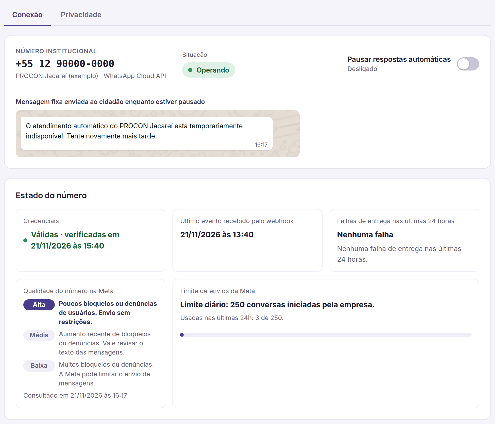
*Figura 24 – Aba Conexão da tela WhatsApp (valores de exemplo)*

- **Número institucional** e **Situação:** mostram o número conectado e se o atendimento está **Operando**, com **Respostas pausadas** ou com algum problema.
- **Pausar respostas automáticas:** liga e desliga as respostas do chatbot. Durante a pausa, quem escrever recebe uma mensagem fixa, mostrada na tela, e o painel avisa que as respostas estão pausadas, com o botão **Reativar respostas**.
- **Estado do número:** mostra se as credenciais estão válidas, o último evento que a Meta enviou ao sistema, as falhas de entrega das últimas 24 horas, a qualidade do número e o limite de envios da Meta.

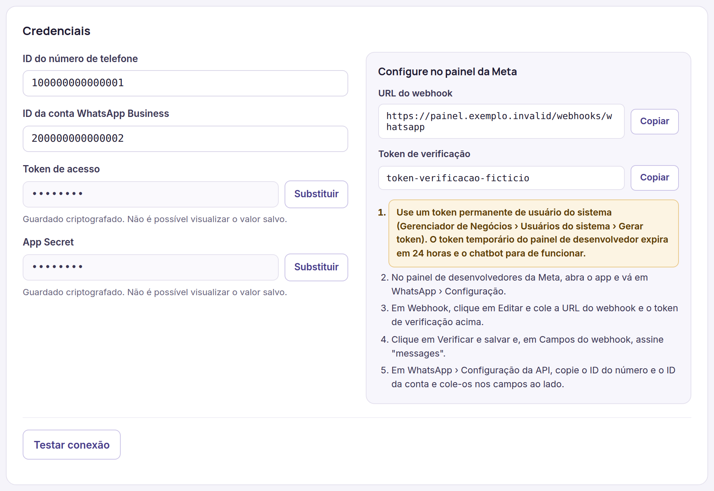
*Figura 25 – Credenciais e orientações para configurar no painel da Meta (valores de exemplo)*

- **Credenciais:** o ID do número de telefone, o ID da conta WhatsApp Business, o token de acesso e o App Secret. Os valores secretos ficam guardados em segredo e não podem ser vistos depois de salvos: só dá para trocá-los, com o botão **Substituir**. O botão **Testar conexão** confere se os dados estão certos antes de salvar.
- **Avisos ao cidadão:** liga e desliga o aviso por WhatsApp quando a equipe cancela um agendamento. Cada aviso tem custo por mensagem cobrado pela Meta, e o painel pede confirmação ao ligar e ao desligar.
- **Modelos de mensagem:** mostra se a Meta já aprovou os dois modelos usados pelo sistema, **Aviso de cancelamento** e **Lembrete do atendimento**. Sem a aprovação, o aviso e o lembrete não são enviados. O botão **Atualizar status da Meta** consulta de novo.
- **Histórico de alterações:** registra quem mudou as credenciais, pausou o chatbot ou ligou e desligou os avisos. Os valores secretos nunca são registrados.

Se aparecer "Não foi possível consultar a Meta. Confira as credenciais e tente novamente.", as credenciais ainda não estão corretas ou a Meta não respondeu. Use **Testar conexão** e **Atualizar status da Meta**.

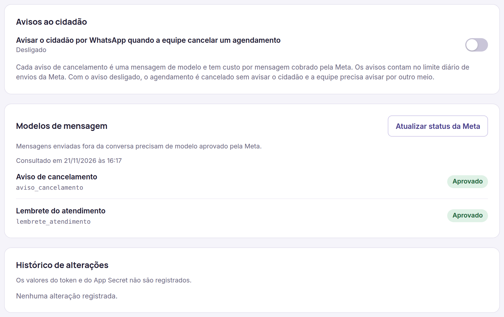
*Figura 26 – Avisos ao cidadão, modelos de mensagem e histórico de alterações (valores de exemplo)*

### Aba Privacidade

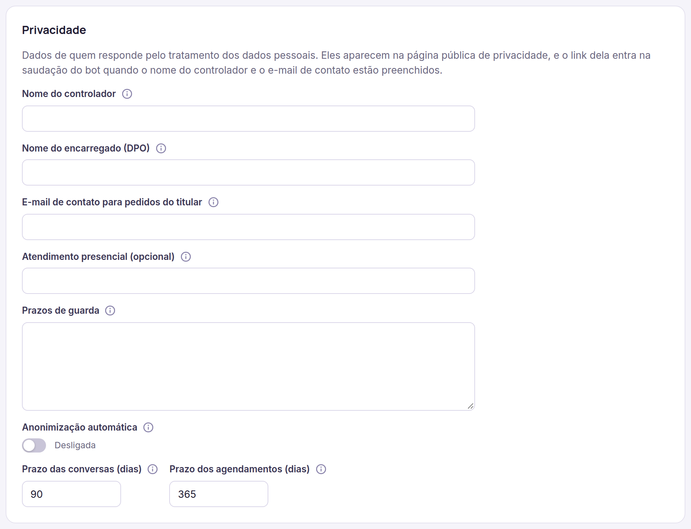
*Figura 27 – Aba Privacidade da tela WhatsApp*

Reúne os dados de quem responde pelo tratamento dos dados pessoais: **Nome do controlador**, **Nome do encarregado (DPO)**, **E-mail de contato para pedidos do titular**, **Atendimento presencial (opcional)** e **Prazos de guarda**. Eles aparecem na página pública de privacidade, e o link dela entra na saudação do chatbot quando o nome do controlador e o e-mail de contato estão preenchidos.

A **Anonimização automática**, quando ligada, apaga por prazo a ligação das conversas com o número de telefone e o nome e o CPF dos agendamentos mais antigos, nos prazos escolhidos em **Prazo das conversas (dias)** e **Prazo dos agendamentos (dias)**. O painel pede confirmação antes de ligar e informa quantos registros seriam anonimizados.

> **Atenção:** a anonimização não pode ser desfeita.

<h1 id="s11">10. Permissões</h1>

Cada conta do painel só enxerga e só faz o que as suas permissões liberam. A tabela abaixo mostra o que cada uma libera.

| Permissão | Libera |
|---|---|
| Ver agendamentos | Lista, calendário e detalhe |
| Gerenciar agendamentos (inclui Ver) | Assumir, atribuir, registrar atendimento, cancelar, observações |
| Gerenciar conteúdo do chatbot | Categorias e perguntas |
| Configurar atendimento presencial | Grade, duração, vagas, janela, bloqueios, dados da unidade, lembrete |
| Configurar documentos para atendimento presencial | Listas de documentos do titular e do representante |
| Ver sessões | Consulta das conversas, somente leitura |
| Ver relatórios | Indicadores e exportação |
| Gerenciar usuários | Criar contas, ativar/desativar, editar permissões |

A exportação de relatórios ainda não está disponível.

Alguns pontos importantes:

- **Existe uma única conta Admin**, com todas as permissões. Ela não pode ser desativada, perder permissões nem ter a senha redefinida por outra pessoa. Só ela acessa a tela **WhatsApp**.
- **Não existem perfis nem cargos.** Toda conta nasce sem nenhuma permissão, e quem tem **Gerenciar usuários** monta cada conta marcando as permissões uma a uma na tela **Usuários**.
- **Gerenciar agendamentos** inclui **Ver agendamentos**.
- Só se concede ou remove uma permissão que você mesmo tem.

<h1 id="s12">11. Sugestões de combinações</h1>

Como o sistema não tem perfis prontos, esta página traz **sugestões** de quais permissões marcar para três situações comuns. São apenas sugestões, e você pode ajustar cada uma conforme a necessidade do PROCON. Para marcar as permissões, use a tela **Usuários** (capítulo 8). A figura mostra como fica o menu de cada uma das três combinações.

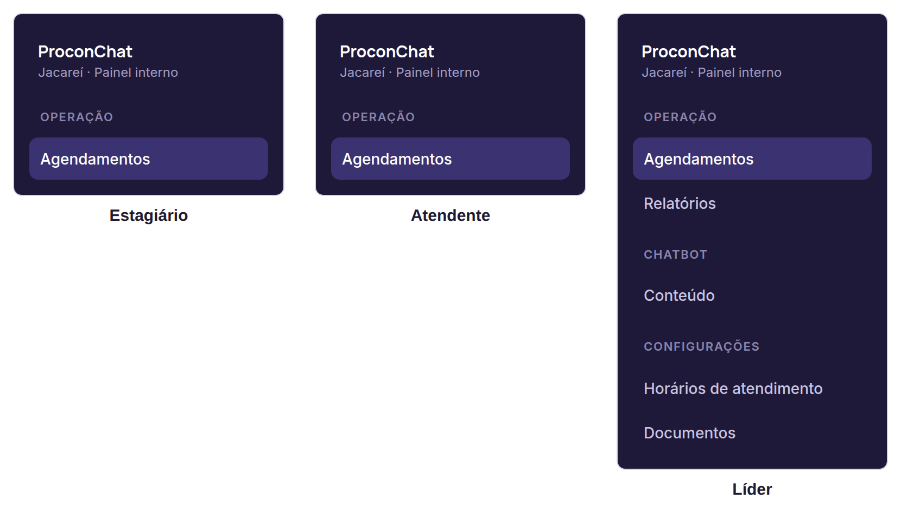
*Figura 28 – Menus de contas de estagiário, atendente e líder (exemplos)*

### Estagiário

Marque só **Ver agendamentos**. A pessoa consulta a lista, o calendário e o detalhe dos agendamentos, mas não muda nada.

### Atendente

Marque só **Gerenciar agendamentos**, que já inclui **Ver agendamentos**. A pessoa assume agendamentos, atribui a colegas, registra se o cidadão foi atendido ou faltou, cancela e escreve observações.

### Líder

Marque todas as permissões que aparecem na tela **Usuários**, menos **Gerenciar usuários**. Hoje são seis: **Ver agendamentos**, **Gerenciar agendamentos**, **Gerenciar conteúdo do chatbot**, **Configurar atendimento presencial**, **Configurar documentos para atendimento presencial** e **Ver relatórios**.

> **Atenção:** com esta combinação, a pessoa líder não consegue criar contas nem mudar permissões. Assim, só a conta Admin gerencia as contas. E quem cria uma conta precisa ter todas as permissões que vai conceder a ela: para criar uma conta de líder com estas seis permissões, quem cria precisa tê-las também (a conta Admin tem todas).

<h1 id="s13">Apêndice A. Redefinir a senha do Admin no servidor</h1>

> **Atenção:** este apêndice é só para a equipe técnica. Quem usa o painel no dia a dia não precisa dele.

O painel não redefine a senha da conta Admin, e não existe "Esqueci minha senha". Se o Admin esquecer a senha, a equipe técnica redefine direto no servidor, como descrito aqui. O e-mail do Admin não muda.

<h2 id="s13-01">Antes de começar</h2>

- Entre no servidor com o usuário `deploy` e abra um terminal interativo. O script não roda sem ele.
- Vá para a pasta da instalação, `/opt/proconchat`.
- A senha nova precisa ter de 8 caracteres a 72 bytes.

<h2 id="s13-02">Passo a passo</h2>

1. Rode o script:

   ```bash
   /opt/proconchat/deploy/reset-admin-password.sh
   ```

2. Digite a senha nova e, em seguida, repita a senha. O script não mostra o que é digitado.
3. Aguarde. O script descobre sozinho a versão do sistema em uso, lendo o registro de entregas, e roda a redefinição dentro do sistema.
4. A senha só foi trocada se aparecerem as mensagens "Senha do Admin redefinida. O e-mail do Admin não mudou." e "Entre no painel com a senha nova.".
5. Entre no painel com o e-mail do Admin e a senha nova.

Ao redefinir, todas as sessões abertas do Admin são encerradas, e a pessoa precisa entrar de novo. A senha não aparece na linha de comando, no histórico do terminal nem no arquivo de configuração.

<h2 id="s13-03">Se o script falhar</h2>

Em qualquer falha, o script termina com uma mensagem e a senha do Admin não é alterada. Veja o que cada mensagem pede:

| Mensagem | O que fazer |
| --- | --- |
| rode este script em um terminal interativo | Abra uma sessão com terminal e rode de novo. Não use o script em tarefas automáticas |
| as senhas não são iguais; nada foi alterado | Rode de novo e digite a mesma senha nas duas vezes |
| a senha precisa ter pelo menos 8 caracteres; nada foi alterado | Escolha uma senha com 8 caracteres ou mais |
| a senha não pode passar de 72 bytes; nada foi alterado | Escolha uma senha mais curta. Acentos ocupam mais de um byte |
| nenhum deploy registrado em releases.log; defina IMAGE_TAG | O sistema não tem entrega registrada. Use o procedimento sem o script, abaixo, informando a versão em uso |
| compose.prod.yaml e .env precisam existir em (pasta) | O script foi rodado de uma instalação incompleta. Confira a pasta `/opt/proconchat` |
| não foi possível redefinir a senha do Admin; veja a mensagem acima | Leia a mensagem anterior. Se for "No Admin account found. Run the seed first (npm run db:seed or the seed service)", a conta Admin ainda não existe: rode a carga inicial do sistema e tente de novo |

<h2 id="s13-04">Sem o script</h2>

O mesmo resultado sai com os comandos abaixo, também como usuário `deploy`. A senha vale só para este comando e não é gravada no arquivo de configuração:

```bash
cd /opt/proconchat
export IMAGE_TAG="$(tail -n 1 releases.log | cut -d' ' -f2)"
read -r -s -p "Senha nova: " ROOT_PASSWORD; export ROOT_PASSWORD
docker compose -f compose.prod.yaml run --rm seed node dist/db/scripts/resetAdminPassword.js
unset ROOT_PASSWORD
```

A mensagem "Senha do Admin redefinida" no fim do comando confirma a troca.
