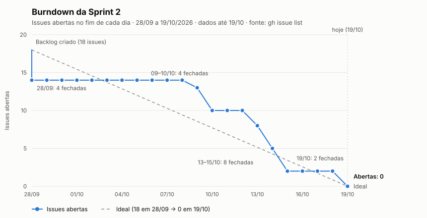

# Sprint 2 — ProconChat Jacareí

> Acompanhamento da Sprint 2 do projeto ABP do 6º DSM (Fatec Jacareí, 2026-2), em parceria com o PROCON de Jacareí-SP.
> Período da Sprint 2 conforme cronograma oficial: **15/09/2026 a 19/10/2026**.
> Repositório: `Steel-Hard/ProconChat_Jacarei` · branch de integração: `develop` · board: GitHub Project #2 da org `Steel-Hard`.
> **Documento parcial**, com dados de **16/10/2026** (faltam 3 dias para o fim da sprint). O fechamento será feito em 19/10.

---

## Arquivos

| Arquivo | Conteúdo |
|---|---|
| [README.md](README.md) | Placar, tarefas concluídas com datas, tarefas em aberto e riscos |
| [burndown.md](burndown.md) · [burndown.svg](burndown.svg) | Gráfico, série diária e leitura do burndown |
| [fluxo-conversa.md](fluxo-conversa.md) | Visão do fluxo conversacional, eventos, desfechos e proteção contra persistência de texto livre |

---

## 1. Placar em 16/10

| Item | Valor |
|---|---|
| Issues da sprint (label `SPRINT 2`) | **18** (17 criadas em 28/09 + #16, que veio da Sprint 1) |
| Concluídas (Done) | **16** (89%) |
| Em aberto | **2** (#85, #86), ambas em **Ready** e sem commits na `develop` |
| Reprovadas na revisão em 10/10 e refeitas | **3** (#55, #56, #60), todas concluídas depois |
| Linha ideal em 16/10 | ~2,6 abertas |
| Situação | **Em dia**, ligeiramente à frente da linha ideal (2 abertas contra 2,6) |

Por tamanho (o tamanho declarado no corpo de cada issue):

| Tamanho | Concluídas | Em aberto |
|---|---|---|
| P | 4 (#50, #61, #82, #84) | 0 |
| M | 9 (#16, #51, #53, #54, #57, #58, #60, #81, #83) | 2 (#85, #86) |
| G | 3 (#52, #55, #56) | 0 |

> O campo de tamanho do board diverge do corpo da issue em quatro casos: #51 e #53 estão como L no board e M na issue, #84 como M no board e P na issue, e #86 como L no board e M na issue. Este documento usa o tamanho da issue, como na versão anterior.

Entre 13/10 e 15/10 foram fechadas 8 issues: o registro de eventos (#16), a autenticação do backend (#57), o novo fluxo da dúvida (#55), o agendamento presencial (#56), a API de agendamentos (#60), a configuração do WhatsApp no banco (#83), a tela de login e Minha conta (#84) e a tela de WhatsApp (#54). Faltam só as duas telas de agendamento.

---

## 2. Tarefas concluídas (Done)

Horários no fuso de Brasília. **Início** é o primeiro sinal de trabalho na issue: a ida para "In progress" no board quando ela ficou registrada (#52 e #58), ou, nas demais, o primeiro commit com `[#N]` na `develop`. **Fim** é o fechamento da issue no merge do PR.

| # | Tarefa | Tamanho | Responsável | Início | Fim | Duração | PR |
|---|---|---|---|---|---|---|---|
| #52 | Migrations do schema da Sprint 2 | G | felipe-sant | 28/09 00:52 | 28/09 19:34 | mesmo dia | #89 |
| #58 | Frontend: estrutura a partir do template-react, Docker e CI | M | felipe-sant | 27/09 23:41 | 28/09 22:20 | 1 dia | #91 |
| #61 | Seed da configuração inicial e títulos curtos do conteúdo | P | felipe-sant | 28/09 20:09 | 28/09 21:23 | mesmo dia | #90 |
| #50 | CI no monorepo (build, lint e testes em cada PR) | P | felipe-sant | 28/09 21:54 | 28/09 22:20 | mesmo dia | #91 |
| #53 | Gateway: WhatsApp Cloud API (receber e enviar mensagens) | M | felipe-sant | 02/10 17:15 | 09/10 19:45 | 7 dias | #95 |
| #51 | Ambiente de produção em VM com deploy contínuo | M | felipe-sant | 09/10 20:30 | 10/10 01:26 | 1 dia | #96 |
| #82 | Remover Evolution API e Redis e documentar o app de teste da Meta | P | felipe-sant | 10/10 01:39 | 10/10 01:57 | mesmo dia | #97 |
| #81 | Frontend: layout do painel e componentes compartilhados | M | felipe-sant | 10/10 11:20 | 10/10 17:57 | mesmo dia | #98 |
| #16 | Registro de eventos da conversa e desfechos | M | claudsaints | 12/10 23:39 | 13/10 21:04 | 1 dia | #101 |
| #57 | Autenticação: backend (login, sessão, permissões e conta Admin) | M | claudsaints | 12/10 23:59 | 13/10 23:36 | 1 dia | #100, #103 |
| #55 | Bot: novo fluxo da dúvida (listas, "resolveu?", desfechos e timeout) | G | Nickaqui | 05/10 20:18 | 14/10 17:48 | 9 dias | #104 |
| #83 | Configuração do WhatsApp no banco: credenciais criptografadas, teste de conexão e pausa | M | felipe-sant | 14/10 18:49 | 14/10 20:22 | mesmo dia | #106 |
| #84 | Autenticação: tela de login e Minha conta | P | felipe-sant | 14/10 22:09 | 14/10 23:56 | mesmo dia | #108 |
| #56 | Bot: agendamento presencial e horários livres | G | Nickaqui | 05/10 20:52 | 15/10 17:49 | 10 dias | #105 |
| #54 | Tela de WhatsApp: credenciais, teste de conexão e pausa | M | felipe-sant | 15/10 18:58 | 15/10 21:09 | mesmo dia | #109 |
| #60 | API de agendamentos: lista, detalhe e ações de status | M | Nickaqui | 15/10 20:25 | 15/10 22:07 | mesmo dia | #107 |

> O histórico de status do board está incompleto: a maior parte das mudanças de coluna não ficou registrada na API do GitHub. Por isso, o início das tarefas sem "In progress" registrado vem do primeiro commit, e o tempo real de trabalho pode ter começado antes.
>
> - **#60:** o primeiro commit com `[#60]` na `develop` é de 15/10, porque o PR chegou com um único commit de rebase. A implementação existia antes, tanto que foi reprovada na revisão de 10/10.
> - **#57:** a primeira versão foi revertida (PR #102, 13/10) e refeita pela spec no PR #103. O PR #100 ajustou a conta Admin do seed no CI.
> - **#55 e #56:** o início em 05/10 é o primeiro commit da primeira versão, reprovada em 10/10 e refeita depois do #16.

---

## 3. Tarefas em aberto

| # | Tarefa | Tamanho | Responsável | Status | Depende de | Situação |
|---|---|---|---|---|---|---|
| #85 | Tela de Agendamentos (lista) | M | felipe-sant | Ready | #60 ✅, #84 ✅, #81 ✅ | Desbloqueada desde 15/10. Ainda sem commits na `develop` |
| #86 | Tela de Detalhe do agendamento | M | felipe-sant | Ready | #60 ✅, #84 ✅, #81 ✅ | Desbloqueada desde 15/10. Ainda sem commits na `develop` |

---

## 4. Riscos

1. **Duas telas em 3 dias.** #85 e #86 precisam ser feitas e revisadas até 19/10. Ambas dependem só de entregas já concluídas, mas nenhuma começou.
2. **Concentração:** das 16 concluídas, 11 foram entregues por felipe-sant, 3 por Nickaqui (#55, #56, #60) e 2 por claudsaints (#16, #57). As duas que faltam também estão com felipe-sant.
3. **Fechamentos concentrados no fim:** 8 das 16 entregas saíram entre 13/10 e 15/10, depois de um platô de 10 dias sem fechamentos (29/09 a 08/10).
4. **Retrabalho:** #55, #56 e #60 foram implementadas antes das dependências, reprovadas em 10/10 e refeitas. A #57 teve a primeira versão revertida e refeita.
5. **Início tardio:** o backlog da sprint só foi criado em 28/09, 13 dias depois do início oficial (15/09).
