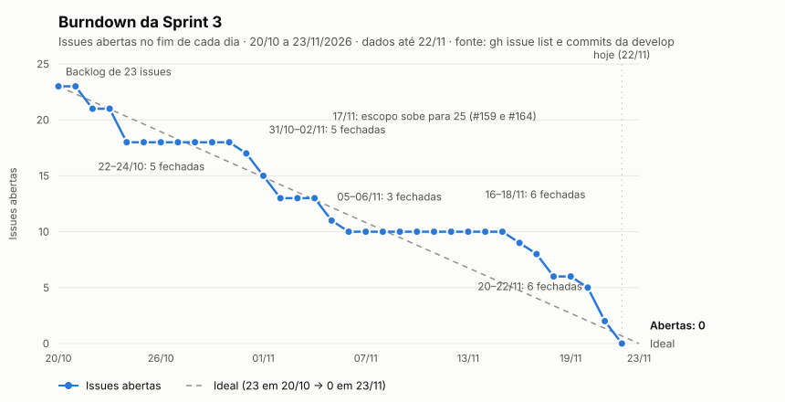

# Sprint 3 · Burndown

> Parte do [fechamento da Sprint 3](README.md). Dados até **22/11/2026**, quando a #70 foi mergeada; a sprint termina em 23/11/2026.

## 1. Issues da sprint com datas (fonte do burndown)

Datas no fuso de Brasília. **Início** é o primeiro commit com `[#N]` na `develop` ou o primeiro commit do PR, o que for mais antigo. **Fechada** é o merge do PR que fechou a issue; na #121 e na #159, que não têm PR, é o fechamento da issue. Cada issue conta 1 no burndown, sem peso por tamanho. A #122 (unificada na #121) e a #120 (unificada na #118) não contam. Entre 27/09 e 19/10 entraram 23 issues, e a #159 e a #164 entraram no meio da sprint.

| # | Tamanho | Entrou na sprint | Início | Fechada | PR |
|---|---|---|---|---|---|
| #62 | M | 27/09 | 20/10 19:54 | 22/10 15:29 | #130 |
| #87 | P | 28/09 | 22/10 15:41 | 22/10 23:49 | #132 |
| #123 | M | 19/10 | 23/10 00:12 | 24/10 12:01 | #133 |
| #64 | M | 27/09 | 22/10 23:16 | 24/10 15:20 | #131 |
| #125 | M | 19/10 | 24/10 16:39 | 24/10 21:51 | #135 |
| #67 | M | 27/09 | 31/10 20:29 | 31/10 22:42 | #141 |
| #59 | M | 27/09 | 01/11 11:19 | 01/11 13:16 | #142 |
| #88 | M | 28/09 | 01/11 15:48 | 01/11 18:54 | #144 |
| #69 | P | 27/09 | 01/11 19:53 | 02/11 12:11 | #145 |
| #66 | M | 27/09 | 02/11 12:48 | 02/11 14:56 | #146 |
| #63 | M | 27/09 | 27/10 20:21 | 05/11 19:03 | #138 |
| #68 | P | 27/09 | 26/10 20:59 | 05/11 23:19 | #137 |
| #129 | P | 19/10 | 04/11 19:58 | 06/11 12:48 | #150 |
| #121 | P | 19/10 | — | 16/11 19:50 | — |
| #65 | P | 27/09 | 04/11 22:03 | 17/11 16:27 | #160 |
| #126 | M | 19/10 | 07/11 15:18 | 17/11 19:19 | #161 |
| #127 | P | 19/10 | 07/11 14:40 | 17/11 22:56 | #163 |
| #164 | M | 17/11 | 17/11 23:06 | 18/11 08:24 | #165 |
| #128 | M | 19/10 | 09/11 20:00 | 18/11 11:29 | #157 |
| #118 | M | 19/10 | 20/11 22:00 | 20/11 23:29 | #171 |
| #124 | M | 19/10 | 20/11 23:45 | 21/11 14:35 | #172 |
| #159 | — | 17/11 | — | 21/11 14:44 | — |
| #119 | M | 19/10 | 21/11 15:38 | 21/11 18:30 | #175 |
| #18 | M | 27/09 | 22/11 16:01 | 22/11 16:56 | #177 |
| #70 | P | 27/09 | 22/11 17:37 | 22/11 21:36 | #178 |

A #70 é a issue de fechamento: foi mergeada no retrato e fecha com o PR da própria documentação.

## 2. Série do burndown (data → issues abertas restantes)

O escopo começa com 23 issues em 20/10 e cresce com a #159 e a #164, em 17/11. A linha ideal vai de 23 em 20/10 a 0 em 23/11 (34 dias, cerca de 0,68 issue por dia) e não considera as duas que entraram depois.

| Data | Escopo | Fechadas no dia | **Abertas (restantes)** | Ideal | Diferença |
|---|---|---|---|---|---|
| 20/10 | 23 | 0 | **23** | 23,0 | em dia |
| 21/10 | 23 | 0 | **23** | 22,3 | 1 atrás |
| 22/10 | 23 | 2 (#62, #87) | **21** | 21,6 | 1 à frente |
| 23/10 | 23 | 0 | **21** | 21,0 | em dia |
| 24/10 | 23 | 3 (#123, #64, #125) | **18** | 20,3 | 2 à frente |
| 25/10 | 23 | 0 | **18** | 19,6 | 2 à frente |
| 26/10 | 23 | 0 | **18** | 18,9 | 1 à frente |
| 27/10 | 23 | 0 | **18** | 18,3 | em dia |
| 28/10 | 23 | 0 | **18** | 17,6 | em dia |
| 29/10 | 23 | 0 | **18** | 16,9 | 1 atrás |
| 30/10 | 23 | 0 | **18** | 16,2 | 2 atrás |
| 31/10 | 23 | 1 (#67) | **17** | 15,6 | 1 atrás |
| 01/11 | 23 | 2 (#59, #88) | **15** | 14,9 | em dia |
| 02/11 | 23 | 2 (#69, #66) | **13** | 14,2 | 1 à frente |
| 03/11 | 23 | 0 | **13** | 13,5 | 1 à frente |
| 04/11 | 23 | 0 | **13** | 12,9 | em dia |
| 05/11 | 23 | 2 (#63, #68) | **11** | 12,2 | 1 à frente |
| 06/11 | 23 | 1 (#129) | **10** | 11,5 | 2 à frente |
| 07/11 | 23 | 0 | **10** | 10,8 | 1 à frente |
| 08/11 | 23 | 0 | **10** | 10,1 | em dia |
| 09/11 | 23 | 0 | **10** | 9,5 | 1 atrás |
| 10/11 | 23 | 0 | **10** | 8,8 | 1 atrás |
| 11/11 | 23 | 0 | **10** | 8,1 | 2 atrás |
| 12/11 | 23 | 0 | **10** | 7,4 | 3 atrás |
| 13/11 | 23 | 0 | **10** | 6,8 | 3 atrás |
| 14/11 | 23 | 0 | **10** | 6,1 | 4 atrás |
| 15/11 | 23 | 0 | **10** | 5,4 | 5 atrás |
| 16/11 | 23 | 1 (#121) | **9** | 4,7 | 4 atrás |
| 17/11 | 25 | 3 (#65, #126, #127) | **8** | 4,1 | 4 atrás |
| 18/11 | 25 | 2 (#164, #128) | **6** | 3,4 | 3 atrás |
| 19/11 | 25 | 0 | **6** | 2,7 | 3 atrás |
| 20/11 | 25 | 1 (#118) | **5** | 2,0 | 3 atrás |
| 21/11 | 25 | 3 (#124, #159, #119) | **2** | 1,4 | 1 atrás |
| 22/11 | 25 | 2 (#18, #70) | **0** | 0,7 | 1 à frente |

## 3. Leitura do burndown

- **20/10 a 21/10:** a sprint começou com 23 issues abertas e nenhum fechamento nos dois primeiros dias.
- **22/10 a 24/10:** 5 fechamentos (#62, #87, #123, #64, #125) deixaram a sprint até 2 issues à frente da linha ideal.
- **25/10 a 30/10:** platô de 6 dias em 18 abertas, sem fechamento. A sprint passou de 2 issues à frente para 2 atrás.
- **31/10 a 02/11:** 5 fechamentos (#67, #59, #88, #69, #66) levaram a sprint de volta à frente da linha.
- **05/11 e 06/11:** 3 fechamentos (#63, #68, #129); restaram 10 abertas.
- **07/11 a 15/11:** platô de 9 dias em 10 abertas, sem fechamento. O atraso chegou a 5 issues em 15/11. As 10 abertas eram telas do painel (#65, #124, #126, #127 e #128), a validação (#121), os guias em PDF (#118 e #119), o teste ponta a ponta (#18) e a #70.
- **16/11 a 18/11:** 6 fechamentos (#121, #65, #126, #127, #164 e #128). Em 17/11 o escopo subiu de 23 para 25 com a #159 e a #164, e a #164 fechou em 18/11.
- **19/11 a 22/11:** 6 fechamentos (#118, #124, #119, #159, #18 e a #70), e a sprint zerou em 22/11, um dia antes do fim.

**Padrão observado:** como nas Sprints 1 e 2, o burndown é em degraus, com fechamentos concentrados em poucos dias e platôs longos. Dos 25 itens, 11 fecharam nos últimos 7 dias da sprint (17/11 a 23/11).
