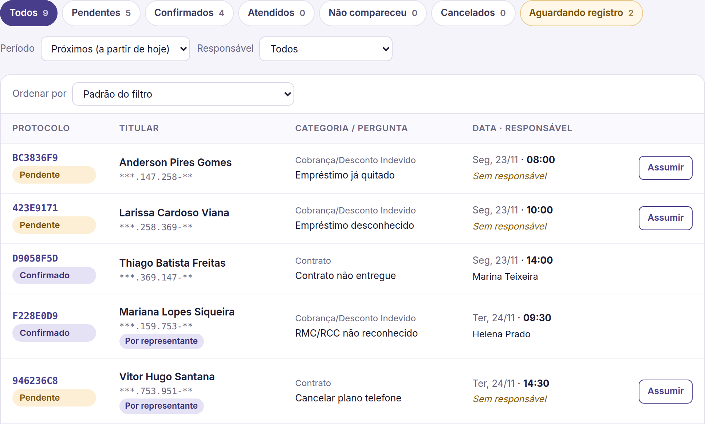
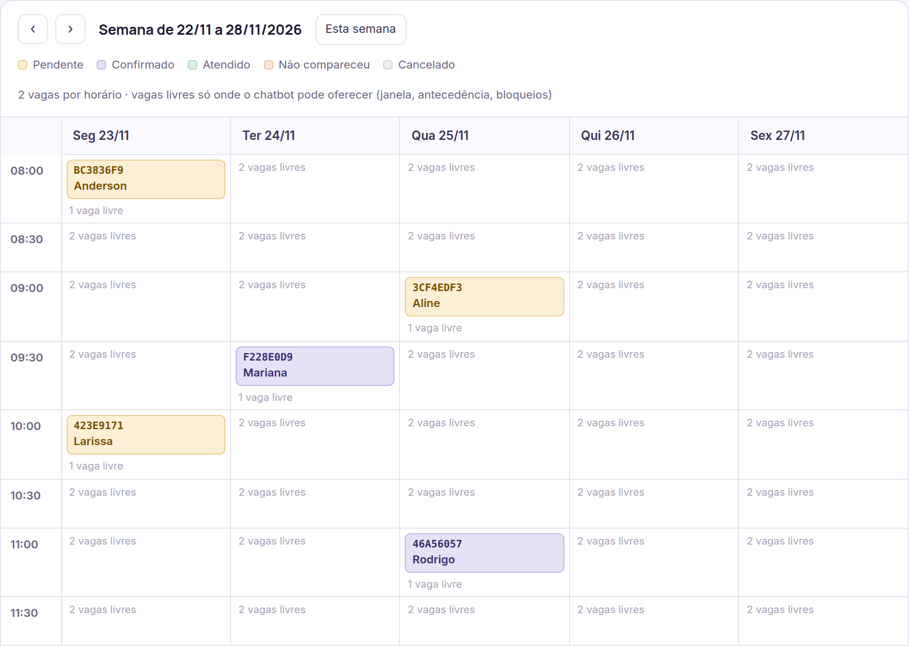

# ProconChat Jacareí

[](https://github.com/Steel-Hard/ProconChat_Jacarei/actions/workflows/ci.yml)
[](https://github.com/Steel-Hard/ProconChat_Jacarei/actions/workflows/deploy.yml)

Produção: <https://3.150.166.93.sslip.io>. Operação e deploy: [`.docs/infra/deploy.md`](.docs/infra/deploy.md).

Documentação do projeto: [`.docs/README.md`](.docs/README.md) (requisitos, decisões, regras das telas,
arquitetura, banco e protótipo do painel).

**Chatbot para Orientação ao Consumidor via WhatsApp**

## Sumário

- [Descrição](#descrição)
- [Demonstração e fluxo do cidadão](#demonstração-e-fluxo-do-cidadão)
- [Objetivos](#objetivos)
- [Tecnologias](#tecnologias)
- [Limites da entrega](#limites-da-entrega)
- [Scrum](#scrum)
- [Product Backlog](#product-backlog)
- [Restrições do Projeto](#restrições-do-projeto)
- [Definition of Done](#definition-of-done)
- [User Stories](#user-stories)
- [Guias de uso](#guias-de-uso)
- [Instalação](#instalação)
- [Testes e CI](#testes-e-ci)
- [Operação e diagnóstico](#operação-e-diagnóstico)
- [Documentação técnica](#documentação-técnica)
- [Dev Team](#dev-team)
- [Parceiro](#parceiro)
- [Convenções de Commit](#convenções-de-commit)
- [Licença](#licença)

---

## Descrição

O **ProconChat Jacareí** é um projeto acadêmico desenvolvido no 6º
semestre do curso de Desenvolvimento de Software Multiplataforma da
**FATEC Jacareí**, em parceria com o **PROCON --- Fundação de Proteção e
Defesa do Consumidor de Jacareí-SP**.

O projeto tem como tema o desenvolvimento de um **Chatbot para
Orientação ao Consumidor via WhatsApp**.

O sistema orienta cidadãos sobre direitos
do consumidor, procedimentos de reclamação, prazos, documentos
necessários e possíveis encaminhamentos. O chatbot conduz o
usuário por fluxos decisórios definidos pelo PROCON, apresentando
perguntas e opções de forma estruturada e intuitiva.

Ao final do fluxo de orientação, o sistema gera uma resposta orientadora
consolidada, indicando os próximos passos recomendados ao consumidor.
Quando permitido pela pergunta, essa resposta pode ser complementada por um
**modelo de linguagem (LLM)** utilizado exclusivamente para geração
textual explicativa, sempre respeitando os limites e informações
definidos pelo PROCON.

> **Importante:** a solução possui caráter exclusivamente orientativo e
> não substitui o atendimento jurídico, administrativo ou formal
> realizado pelo PROCON.

Caso o chatbot não consiga solucionar adequadamente a dúvida do cidadão,
o sistema possibilita o **agendamento de atendimento
presencial**, orientando também sobre possíveis documentos necessários
para a consulta.

---

## Demonstração e fluxo do cidadão

1. O cidadão entra em contato pelo WhatsApp e escolhe uma **categoria** e uma **pergunta**.
2. O bot apresenta a orientação oficial, com os próximos passos e o aviso de caráter informativo.
   Quando permitido e disponível, o LLM reescreve a explicação, identificada como "Gerado com auxílio de IA".
3. O bot pergunta se a orientação resolveu a dúvida ou oferece atendimento presencial, conforme a pergunta.
   Se a orientação não resolver, o cidadão também pode seguir para o agendamento.
4. No agendamento, o cidadão informa quem comparecerá, nome e CPF, escolhe um horário disponível
   e recebe a confirmação com protocolo e documentos necessários.

Quem já tem um agendamento futuro encontra as opções **Remarcar**, **Cancelar** e **Tenho outra dúvida**.
Perguntas fora do escopo recebem o encaminhamento correspondente, sem complemento por IA nem oferta de agendamento.
As regras completas estão na [decisão sobre o fluxo da conversa](.docs/decisoes/008-fluxo-da-conversa-e-desfechos.md).

<details>
<summary>Ver capturas do painel: lista e calendário de agendamentos</summary>





As capturas fazem parte do [manual do painel](.docs/guias/manual-do-painel.pdf), que apresenta as demais telas e permissões.

</details>

---

## Objetivos

O projeto busca:

- Ampliar o acesso dos cidadãos às informações fornecidas pelo PROCON;
- Reduzir a demanda causada por dúvidas e perguntas recorrentes;
- Orientar o consumidor sem exigir, inicialmente, seu deslocamento até
  a unidade do PROCON;
- Conduzir o usuário por fluxos decisórios previamente definidos;
- Fornecer respostas claras, objetivas e acessíveis;
- Permitir o agendamento presencial quando a orientação automatizada
  não for suficiente;
- Disponibilizar uma interface web para gerenciamento dos atendimentos
  agendados;
- Registrar as interações para permitir análise posterior dos fluxos
  mais utilizados;
- Respeitar os princípios e requisitos da **LGPD** durante o
  tratamento das informações dos usuários.

---

## Tecnologias

| Camada | Tecnologia | Estado |
|---|---|---|
| Backend e Gateway | Node.js + TypeScript (Express), Vitest | Implementado |
| Banco | PostgreSQL 15, migrations com `node-pg-migrate` | Implementado |
| LLM | Ollama + `llama3.2:3b`, local (RP05: nenhuma API externa de LLM) | Implementado, ligado ao fluxo (#66) |
| WhatsApp | **WhatsApp Cloud API** oficial | Implementado |
| Painel web | React 19 + Vite + TypeScript, a partir do `template-react` | Implementado: login, "Minha conta", Agendamentos, Detalhe do agendamento, Conteúdo, Horários, Documentos, Usuários, Relatórios, WhatsApp e política de privacidade. Dashboard e Sessões foram descartados por decisão do grupo |
| Infraestrutura | Docker Compose, GitHub Actions (CI/CD), VM na nuvem com HTTPS | Implementado |

Detalhes em [`.docs/architecture/architecture.md`](.docs/architecture/architecture.md).

### Uso da IA e resposta oficial

O Motor de Decisão define o fluxo e o conteúdo oficial. O LLM apenas reescreve a explicação,
sem receber o telefone ou o texto digitado pelo cidadão. Se a IA estiver indisponível, ocupada,
falhar ou exceder o tempo limite, o sistema usa a resposta oficial completa.

O `compose.yaml` de desenvolvimento sobe o Ollama local. Na VM de produção, o modo padrão
**documentado** é sem Ollama, por limitação de memória. A produção também pode usar um Ollama
em outra máquina própria, pela rede privada, ou na própria VM quando houver memória suficiente.
Isso não utiliza APIs externas de LLM. As opções e as configurações estão no
[guia de produção](.docs/infra/deploy.md#provedor-tamanho-e-custo) e na
[decisão sobre o complemento por IA](.docs/decisoes/009-complemento-por-llm.md).

---

## Limites da entrega

- O atendimento humano acontece **presencialmente**, mediante agendamento; não há transferência da
  conversa para um atendente no WhatsApp ([decisão 011](.docs/decisoes/011-atendimento-humano-no-chat-nao-adotado.md)).
- Os relatórios entregues são os **relatórios mínimos** de interações e agendamentos.
  Exportação em PDF, Excel e CSV e gráficos extras ficaram fora da entrega
  ([fechamento da Sprint 3](.docs/sprints/sprint3/README.md#4-riscos-e-o-que-ficou-de-fora)).
- Dashboard e Sessões foram descartados por decisão do grupo
  ([decisão 013](.docs/decisoes/013-telas-de-sessoes-e-dashboard-descartadas.md)).

---

## Scrum

| Sprint |  Início  |    Fim    |     Status     |          📉 Burndown Chart          | Sprint Backlog/Review |
| :----: | :--------: | :--------: | :-------------: | :----------------------------------: | :-------------------: |
|   1   | 10/08/2026 | 14/09/2026 | 🟢 Concluída | [Ver Gráfico](.docs/sprints/sprint1/burndown.svg) | [Ver](.docs/sprints/sprint1/README.md) |
|   2   | 15/09/2026 | 19/10/2026 | 🟢 Concluída | [Ver Gráfico](.docs/sprints/sprint2/burndown.svg) | [Ver](.docs/sprints/sprint2/README.md) |
|   3   | 20/10/2026 | 23/11/2026 | 🟢 Concluída | [Ver Gráfico](.docs/sprints/sprint3/burndown.svg) | [Ver](.docs/sprints/sprint3/README.md) |

> O gráfico e as tabelas de origem do burndown da Sprint 1 estão em
> [`.docs/sprints/sprint1/05-burndown.md`](.docs/sprints/sprint1/05-burndown.md). Os da Sprint 2 (18 de 18
> issues concluídas) estão em [`.docs/sprints/sprint2/burndown.md`](.docs/sprints/sprint2/burndown.md). Os da Sprint 3 (25 issues
> no escopo, todas concluídas) estão em [`.docs/sprints/sprint3/burndown.md`](.docs/sprints/sprint3/burndown.md).

---

## Product Backlog

| Número | Recurso Funcional         |                                  Síntese do Requisito                                  |   Status   |
| :-----: | ------------------------- | :--------------------------------------------------------------------------------------: | :---------: |
|  RF01  | Integração com WhatsApp |         Permitir a integração do usuário por meio de um chatbot no WhatsApp.         | 🟢 Concluído |
|  RF02  | Tabela de Decisões       |       Apresentar opções de resposta com base nos fluxos fornecidos pelo PROCON.       | 🟢 Concluído |
|  RF03  | Fluxos Decisórios        |       Apresentar perguntas e alternativas de maneira sequencial e compreensível.       | 🟢 Concluído |
|  RF04  | Resposta Orientadora      |      Gerar ao final do fluxo um resumo do caso e os próximos passos recomendados.      | 🟢 Concluído |
|  RF05  | Complemento com LLM       | Permitir geração textual explicativa por LLM dentro dos limites definidos pelo PROCON. | 🟢 Concluído |
|  RF06  | Registro de Interações  |       Registrar interações para análise posterior dos fluxos mais utilizados.       | 🟢 Concluído |
|  RF07  | Agendamento Presencial    |       Realizar agendamento quando o chatbot não solucionar a dúvida do cidadão.       | 🟢 Concluído |
|  RF08  | Gerenciamento Web         |       Disponibilizar interface web para gerenciamento dos atendimentos agendados.       | 🟢 Concluído |

| Número | Recurso Não-Funcional |                                   Síntese do Requisito                                   |   Status   |
| :-----: | ---------------------- | :---------------------------------------------------------------------------------------: | :---------: |
|  RNF01  | Usabilidade            |            Utilizar linguagem clara, objetiva e acessível ao público geral.            | 🟢 Concluído |
|  RNF02  | Disponibilidade        | Garantir alta disponibilidade e tempo de resposta adequado para conversas em tempo real. | 🟢 Concluído |
|  RNF03  | LGPD                   |        Garantir tratamento adequado e proteção das informações dos usuários.        | 🟢 Concluído |
|  RNF04  | Caráter Orientativo   |        Informar explicitamente que as respostas não substituem atendimento formal        | 🟢 Concluído |
|  RNF05  | Transparência LLM     |      Identificar claramente respostas geradas com auxílio de modelos de linguagem.      | 🟢 Concluído |
|  RNF06  | Docker                 |                      Garantir a execução da aplicação em Docker                      | 🟢 Concluído |
|  RNF07  | Documentação         |         Documentar instalação e requisitos necessários de hardware e software.         | 🟢 Concluído |
|  RNF08  | Boas Práticas         | Adotar metodologia ágil, CI/CD, versionamento, testes e documentação técnica mínima. | 🟢 Concluído |

> O status de cada requisito, com a fonte, está na [rastreabilidade](.docs/desafio/rastreabilidade.md). O que foi entregue, testado e o que ficou
> de fora está no fechamento de cada sprint: [Sprint 1](.docs/sprints/sprint1/README.md) ([issues e PRs](.docs/sprints/sprint1/04-issues-e-prs.md),
> [entregas de 14/09](.docs/sprints/sprint1/06-entregas-14-09.md) e [riscos](.docs/sprints/sprint1/07-riscos-e-proximos-passos.md)),
> [Sprint 2](.docs/sprints/sprint2/README.md) e [Sprint 3](.docs/sprints/sprint3/README.md).

---

## Restrições do Projeto

- A integração com o WhatsApp deverá ocorrer preferencialmente pela
  **WhatsApp Business Platform (Cloud API)**;
- Poderão ser utilizados ambientes de teste ou soluções simuladas para
  fins acadêmicos;
- O back-end deverá utilizar tecnologia compatível com aplicações web
  modernas, como Node.js ou Python;
- A arquitetura deverá ser modular, separando:
  - lógica do chatbot;
  - gestão dos fluxos decisórios;
  - integração com modelos de linguagem;
- O escopo deverá ser compatível com o período disponível para
  desenvolvimento durante o semestre;
- **APIs externas de LLM não poderão ser utilizadas**, mesmo quando
  gratuitas;
- O tratamento de dados deverá observar os requisitos da **LGPD**.

---

## Definition of Done

Uma entrega será considerada concluída quando:

- Os requisitos e critérios definidos para a funcionalidade forem
  atendidos;
- O código estiver versionado no repositório do projeto;
- A funcionalidade estiver integrada ao restante da aplicação;
- Os testes aplicáveis tiverem sido executados;
- A documentação relacionada estiver atualizada;
- A entrega estiver disponível em ambiente Docker quando aplicável.

---

## User Stories

As tarefas e os critérios de aceitação foram acompanhados nas
[issues do repositório](https://github.com/Steel-Hard/ProconChat_Jacarei/issues) e no
[Project 6DSM](https://github.com/orgs/Steel-Hard/projects/2), com base nos requisitos e fluxos
fornecidos pelo PROCON. A [rastreabilidade](.docs/desafio/rastreabilidade.md) relaciona os requisitos
às entregas, e os fechamentos das sprints registram o resultado de cada período.

---

## Guias de uso

| Guia | Para quem e para quê | PDF | Texto-fonte |
|---|---|---|---|
| Configuração do bot | Admin e equipe que prepara o WhatsApp, o webhook, os modelos e a privacidade | [Abrir PDF](.docs/guias/guia-configuracao-do-bot.pdf) | [Markdown](.docs/guias/guia-configuracao-do-bot.md) |
| Manual do painel | Equipe do PROCON: telas, agendamentos, conteúdo e permissões | [Abrir PDF](.docs/guias/manual-do-painel.pdf) | [Markdown](.docs/guias/manual-do-painel.md) |
| Documento do software | Equipe técnica: visão geral, requisitos, instalação e operação | [Abrir PDF](.docs/guias/documento-do-software.pdf) | [Markdown](.docs/guias/documento-do-software.md) |

O [guia de geração dos PDFs](.docs/guias/README.md) explica como atualizar os arquivos a partir do Markdown.

---

## Instalação

### Pré-requisitos

- [Docker](https://docs.docker.com/get-docker/) e Docker Compose v2 (`docker compose`, sem hífen);
- `openssl`, para gerar as chaves do `.env` (já vem no Linux e no macOS; no Windows, use o WSL);
- Acesso à internet na primeira subida: o Docker baixa as imagens e o serviço `llm-pull` baixa o modelo de IA (cerca de 2 GB), o que pode demorar;
- Nenhuma outra dependência de host é necessária — Node.js, PostgreSQL e o
  modelo de linguagem rodam todos dentro dos containers.

Os requisitos de hardware (CPU, memória e disco, medidos) e de software para a produção estão no
[documento do software](.docs/guias/documento-do-software.pdf) (texto-fonte em
[`.docs/guias/documento-do-software.md`](.docs/guias/documento-do-software.md)).

### Passo a passo

```bash
git clone https://github.com/Steel-Hard/ProconChat_Jacarei.git
cd ProconChat_Jacarei
cp .env.example .env
openssl rand -hex 32
```

Abra o `.env` e preencha duas variáveis, cada uma com o resultado de `openssl rand -hex 32`
(64 caracteres hexadecimais):

- `ENCRYPTION_KEY`: obrigatória e sem valor padrão. Sem ela, o Docker Compose recusa subir com
  `defina ENCRYPTION_KEY no .env`. Ela cifra as credenciais da Meta guardadas no banco; depois que
  houver credenciais salvas, não a troque (README do backend, "Trocar a `ENCRYPTION_KEY`");
- `AUTH_TOKEN_SECRET`: assina as sessões do painel.

Confira também `ROOT_EMAIL` e `ROOT_PASSWORD`: são o e-mail e a senha da conta Admin criada na primeira
subida. A senha precisa ter de 8 caracteres a 72 bytes. O `.env.example` traz valores de desenvolvimento; troque-os se outras pessoas acessarem a máquina.
Os demais valores do `.env.example` servem para desenvolvimento.

Depois, suba tudo:

```bash
docker compose up --build
```

Na primeira vez, o `llm-pull` baixa o modelo de IA; acompanhe com `docker compose ps -a`. Nem todo
serviço tem healthcheck: `postgres`, `backend` e `ollama` aparecem como `healthy`, `frontend` e `gateway`
como `Up`, e `migrate`, `seed` e `llm-pull` terminam sozinhos com código `0`. Abra o painel exatamente em
`http://localhost:8081` (porta `FRONTEND_PORT`), e não em `127.0.0.1`: nesse endereço o login dá `403`,
pela proteção de origem. Entre com `ROOT_EMAIL` e `ROOT_PASSWORD`. Nesse modo não há HTTPS, e o WhatsApp real não entrega mensagens
à máquina; para isso, use a produção ([`.docs/infra/deploy.md`](.docs/infra/deploy.md)).

No ambiente HTTP local, use Chrome ou Firefox, conforme as
[orientações de autenticação do frontend](src/frontend/README.md#autenticação-no-cliente).
Os valores `ROOT_EMAIL` e `ROOT_PASSWORD` só criam o Admin enquanto essa conta não existe:
alterar o `.env` depois não redefine o acesso. Consulte a
[recuperação da senha do Admin](src/backend/README.md#conta-admin-e-redefinição-da-senha) quando necessário.

Isso sobe, com um único comando, todo o ambiente do MVP:

| Serviço         | Papel                                                              | Porta padrão (host) |
| --------------- | ------------------------------------------------------------------- | :------------------: |
| `postgres`      | Banco de dados (persistência via volume `postgres_data`)           |    `127.0.0.1:5433`    |
| `migrate`       | Aplica as migrations e encerra (`node-pg-migrate`)                  |           —           |
| `seed`          | Carrega o conteúdo, a configuração inicial, a conta Admin e a configuração do WhatsApp, e encerra |           —           |
| `backend`       | API/orquestrador (Motor de Decisão, agenda, API do painel)          |    `127.0.0.1:3000`    |
| `frontend`      | Painel web da equipe (nginx)                                        |    `127.0.0.1:8081`    |
| `gateway`       | Gateway WhatsApp — recebe o webhook e fala com o `backend`         |    `127.0.0.1:3001`    |
| `ollama`        | LLM local (modelo definido por `LLM_MODEL` no `.env`)               |           —           |
| `llm-pull`      | Baixa o modelo do Ollama e encerra                                  |           —           |

As variáveis sensíveis (senhas, tokens, segredos) vêm do `.env`. O `compose.yaml` só traz valores
padrão de desenvolvimento para algumas delas (e nenhum para `ENCRYPTION_KEY`); no `compose.prod.yaml`
todas são obrigatórias no `.env`. Veja `.env.example` para a lista completa.

Ao alterar `BACKEND_PORT`, ajuste também `VITE_API_URL` no `.env` e reconstrua o frontend
com `docker compose up --build -d frontend`. A URL da API é incorporada no build, e o valor
fixado no `.env.example` sobrepõe o padrão calculado pelo Compose.

### Configuração após a instalação

Para o uso real pelo WhatsApp, siga o [guia de configuração do bot](.docs/guias/guia-configuracao-do-bot.pdf):

- Cadastre as credenciais da Meta no painel, teste a conexão e configure o webhook HTTPS.
- Preencha os dados do controlador e de contato na aba **Privacidade** da tela de WhatsApp.
  A página pública `/privacidade` apresenta esses dados e os prazos de guarda; o link entra na
  saudação quando os campos necessários e a URL pública estão configurados.
- Configure os modelos de mensagem aprovados na Meta antes de usar as notificações.
  O **aviso de cancelamento** começa desligado e é ativado na tela **WhatsApp**.
  O **lembrete de atendimento** também começa desligado e é configurado em **Horários de atendimento**.

---

## Testes e CI

Para executar as verificações fora dos containers, use **Node.js 24**; no frontend, siga a versão
de `src/frontend/.nvmrc`. Rode `npm ci` em cada diretório antes dos comandos correspondentes.
O [workflow de CI](.github/workflows/ci.yml) executa as verificações nos PRs para `develop` e `main`.

| Diretório | Verificações |
|---|---|
| `src/frontend` | `npm run format:check`, `npm run lint`, `npm run build`, `npm run test:run` |
| `src/backend` | `npm run lint`, `npm run build`, `npm run typecheck:test`, `npm test` |
| `src/gateway` | `npm run lint`, `npm run build`, `npm test` |

As verificações com PostgreSQL real rodam a partir de `src/backend`:

| Verificação | Comandos | Preparação adicional |
|---|---|---|
| Integração | `npm run test:integration` | `DB_URL` para um banco de testes separado, com migrations aplicadas |
| Migrations e seed | `npm run test:db` | `DB_TEST_URL` e usuário com permissão para criar bancos temporários |
| Ponta a ponta (E2E) | `npm run typecheck:e2e`, `npm run test:e2e` | `npm ci` também em `src/gateway`; `DB_URL` para um banco descartável com migrations aplicadas |

O E2E cobre a orientação que termina em agendamento, a conclusão do atendimento pelo painel e o
retorno do cidadão para remarcar ou cancelar. Ele exercita Gateway e Backend por HTTP, com a saída
para a Meta simulada e a IA desligada; não automatiza o navegador. Use banco separado do ambiente
de uso e não execute integração e E2E ao mesmo tempo no mesmo banco. O preparo completo e as
variáveis necessárias estão no [README do backend](src/backend/README.md#como-rodar).

---

## Operação e diagnóstico

Na raiz do repositório, com o `.env` configurado, estes comandos ajudam a conferir o ambiente local:

```bash
docker compose ps -a
docker compose logs --tail=100 backend gateway postgres
```

Com as portas padrão, os endpoints de saúde são
<http://localhost:3000/health> (backend) e <http://localhost:3001/health> (gateway).
Eles ajudam a conferir se os serviços respondem, sem comprovar uma conversa completa com a Meta.

Para parar e retomar os containers:

```bash
docker compose stop
docker compose start
```

Os volumes `postgres_data` e `ollama_data` preservam o banco e o modelo ao parar os containers.
Para aplicar alterações de código ou configuração, use `docker compose up --build`.

| Necessidade | Guia |
|---|---|
| Recuperar o acesso ao Admin | [Redefinição da senha](src/backend/README.md#conta-admin-e-redefinição-da-senha) |
| Entender falhas de login, credenciais e webhook | [Diagnóstico de produção](.docs/infra/deploy.md#diagnóstico) |
| Fazer backup ou restaurar o banco de produção | [Backup e restauração](.docs/infra/deploy.md#backup-e-restauração) |
| Atualizar a produção ou voltar à imagem anterior | [Deploy manual e rollback](.docs/infra/deploy.md#deploy-manual-e-rollback) |

---

## Documentação técnica

- [`.docs/database/migrations.md`](.docs/database/migrations.md) — schema, migrations e como resetar o banco.
- [`src/backend/README.md`](src/backend/README.md) — rodar o backend fora do Docker, rotas disponíveis, testes.
- [`src/gateway/README.md`](src/gateway/README.md) — subir e validar o Gateway WhatsApp com a Cloud API.
- [`src/frontend/README.md`](src/frontend/README.md) — rodar o painel web fora do Docker, comandos, estrutura e testes.
- [`.docs/llm/contrato.md`](.docs/llm/contrato.md) — contrato de entrada/saída do serviço LLM.
- [`.docs/README.md`](.docs/README.md) — índice de toda a documentação: requisitos, decisões, regras das telas e protótipo.

---

## Dev Team

|                 Nome                 |   Função   |                     GitHub                     |
| :----------------------------------: | :-----------: | :--------------------------------------------: |
| Cláudio dos Santos Siqueira Júnior |   Dev Team   |    [GitHub](https://github.com/claudsaints)    |
|        Lucas Roque Alvim Cruz        |   Dev Team   |     [GitHub](https://github.com/lucasroqe)     |
|        Luiz Felipe dos Santos        | Scrum Master |    [GitHub](https://github.com/felipe-sant)    |
| Maurício Oliveira Medeiros Cepinho | Product Owner |     [GitHub](https://github.com/maucepinho)     |
|           Nícolas Aquino           |   Dev Team   |      [GitHub](https://github.com/Nickaqui)      |
|      Victor Hugo Dantas Carbajo      |   Dev Team   | [GitHub](https://github.com/Victor-Carbajo-DSM) |
|  Vitor Francisco de Azevedo Zonzini  |   Dev Team   |      [GitHub](https://github.com/frevisto)      |

## Parceiro

**PROCON --- Fundação de Proteção e Defesa do Consumidor de Jacareí-SP**

Projeto desenvolvido como parte da metodologia de **Aprendizagem Baseada
em Projetos (ABP)** do 6º semestre de Desenvolvimento de Software
Multiplataforma da **FATEC Jacareí**.

---

## Convenções de Commit

Os padrões de branch, commit e Pull Request estão em
[`CONTRIBUTING.md`](CONTRIBUTING.md).

---

## Licença

Distribuído sob a licença Apache 2.0. Veja [`LICENSE`](LICENSE).
